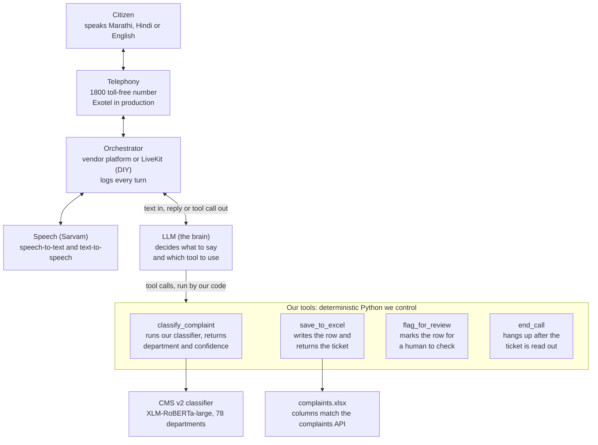

CMS v2's AI classifier reads a citizen complaint written in Marathi, English or a mix of both, and routes it to one of 78 Pune Municipal Corporation (PMC) departments. It scores 86.89% accuracy on 43,764 held-out complaints and 83.26% on 3,167 live complaints from February 2026. It is strong on high-volume departments and weak on rare or ambiguous ones, which we believe is mainly a data and taxonomy problem rather than a model problem.

## 1. The problem we were solving

PMC wanted each citizen complaint routed to the right department automatically. Before this, an operator read every free-text complaint and picked a department by hand, which was slow and inconsistent.

| Constraint | What it forced on the design |
| --- | --- |
| Text arrives in Marathi (Devanagari), English or a mix, and no translation step is allowed | A natively multilingual model; English-only tools ruled out |
| 78 fine-grained department categories, many close in meaning | A high-capacity model; some confusion between neighbouring departments is expected |
| Extreme imbalance: 66,485 training complaints in the largest category, 1 in each of the four smallest | Class-weighted loss, plus synthetic data for rare categories |
| Government deployment | Honest evaluation with per-category metrics, not one headline number |

We set a 92% accuracy target when our best run stood at 73%. The benchmark was an earlier PMC study by VIT (Vishwakarma Institute of Technology, Pune). VIT reported 94% after translating complaints to English, and 90% with IndicBERT on the original text.

VIT predicted 83 categories plus 407 sub-categories and published no test split, so it is a reference point, not a like-for-like comparison. We finished at 86.89%: above our 85% minimum, short of the 92% stretch goal.

## 2. The data

We trained on PMC's own complaint records: 454,495 complaints, each with its free-text description and the department it was routed to. They span 78 departments; 5 more in PMC's 83-category master list had no complaints. The export includes complaints up to at least early February 2026; its full date range is not recorded in the repo.

**Split.** An 80/10/10 split, stratified by category, gave 354,384 training, 44,297 validation and 44,298 test complaints (442,979 in all). The other 11,516 raw rows are in no split. The EDA report attributes this to de-duplication, but the raw export had only 3,068 exact duplicates, so part of the gap is unexplained.

**One record** (Alpaca-style JSONL, one complaint per line):

```json
{"instruction": "Classify the following customer complaint into the correct category.",
 "input": "Today street lights are not functional, please make it functional.",
 "output": "Street Lights"}
```

The instruction is identical on every row and is joined to the complaint text to form the model's input, so inference must do the same. Phone numbers in the text were masked as `[PHONE]` upstream; that masking code is not in the repo.

**What complaints look like.** These are real examples from the February 2026 live batch, with English glosses:

| Language | Complaint | Department |
| --- | --- | --- |
| English | Today street lights are not functional, please make it functional. | Street Lights |
| English | Drainage line chocked up and drainage is damaged | Drainage |
| Marathi | सदर रस्त्यावरील पाच पथदिवे आज लागलेले नाहीत… (Five street lights on this road are off today; please switch them on.) | Street Lights |
| Marathi | पाणी येत नाहीय आम्हाला त्वरित पाण्याची सोय करावी… (No water is coming; please arrange water urgently.) | Water Supply |
| Mixed | Ikde रस्त्याचे अपुरे काम केले आहे. कृपया action घ्यावी. (Road work here is left incomplete; please take action.) | Road, pavement, pits, repair |
| Mixed | Dirty footpaths , fix it EON IT PARK ROAD, kharadi कचरा उचला (… pick up the garbage) | Road Sweeping / Garbage disposal |

Real complaints carry typos, switch script mid-sentence, and sometimes write Marathi in Latin letters ("Ikde" means "here").

**Languages.** On a 10,000-complaint sample per split, 45.2% use Latin script only, 42.5% Devanagari only, and 12.2% both. Romanised Marathi counts as Latin here, so real Marathi use is higher. Validation and test match training within 1 point.

**Length.** The median complaint is 161 characters (26 words); the mean is 229 characters (37.5 words). A word-count heuristic (1.3 tokens per word) put the 99th percentile at about 265 tokens. The real XLM-R token count is likely higher and has not been measured.

**Categories.** The 10 largest departments hold 88.85% of training complaints. Road and pavement repair alone has 66,485, while four departments (Aids Control, BSUP project, JICA project, Land Acquisition) have one each. Eleven departments have 10 or fewer. Figure 1 shows the full spread.

**Figure 1. Ten of 78 departments hold 89% of training complaints** (real training split, 354,384 complaints, before synthetic data):

| Training complaints per department | Departments | Share of training complaints | Largest in the band |
| --- | --- | --- | --- |
| 10,000 or more | 10 | 88.85% | Road and pavement repair 66,485; Road Sweeping 63,380; Drainage 44,000; Water Supply 36,575 |
| 1,000–9,999 | 8 | 7.82% | Unauthorized hoardings 7,598; Public Health Related 4,766; Property Tax Assessment 4,700 |
| 100–999 | 26 | 3.09% | Bridge / Overbridge 910; Property Tax-Computer Section 861; Garden Civil maintenance 795 |
| 11–99 | 23 | 0.23% | Cultural Department 94; Unauthorized slaughterhouse 86; Marriage Registration 84 |
| 1–10 | 11 | 0.01% | General Complaints 9; Chawl Complaints 7; four departments with exactly 1 |

Source: `EDA/category_statistics.csv`.

Counts span five orders of magnitude, so a department's training count, more than the model, sets how well it can be learned.

## 3. Data problems and how we handled them

Before training we found five problems in the data. We fixed the leakage, softened the imbalance, and topped up rare categories; conflicting labels and untestable tiny categories remain.

| Problem | What we found | What we did | Where it stands |
| --- | --- | --- | --- |
| Train/test leakage | 500 validation complaints and 481 distinct test texts were word-for-word copies of training complaints; 59 more test texts copied validation complaints. That would have inflated every score. | Removed the copies from validation and test only, keeping all training data. Validation went 44,297 → 43,797, test 44,298 → 43,764. | Fixed for exact copies. Near-duplicates (different spacing, case or punctuation) were not checked. |
| Extreme imbalance (66,485 : 1) | Unweighted, the model would mostly predict the top few departments. | Class-weighted loss, so each department counts in proportion to its rarity, plus synthetic complaints for rare departments. | The 13 largest departments average 0.856 F1; the long tail is still weak (section 7). |
| Rare departments | 11 departments had 10 or fewer training complaints; 34 had 100 or fewer. | Generated 3,232 synthetic complaints for those 34 departments (section 4). | Done, in training data only; its benefit is unmeasured (section 4). |
| Conflicting labels | 1,707 identical complaint texts carry two or more departments in training (3,500 rows), plus 34 in validation and 39 in test. | Kept them, since many reflect genuine overlap between departments. | Still in the data as label noise. Older notes say 35 were removed; the training file shows none were. |
| Tiny departments missing from evaluation | The split could not place every rare department in each set: test covers 69 of 78 departments, validation 71. | Nothing possible without more real data. | 9 departments, all at least 92% synthetic, cannot be scored on the test set. |

The split itself was well balanced: each department's share differs between sets by 0.02% on average. That measure cannot see departments missing entirely, which is why the last row needed a separate check.

## 4. Synthetic data for rare departments

We used Google Gemini 2.5 Flash to write 3,232 new complaints for 34 rare departments, lifting the rarest from 1 real complaint to 150 training examples. Synthetic complaints went into training only; validation and test stay 100% real.

**How many per department.** The target depended on each department's real training count. Synthetic rows filled the gap. The tiers are not monotonic, exactly as coded in `calculate_synthetic_data_targets.py`: a department with 100 real complaints ends at 150, while one with 101 gets none.

| Real training complaints | Target total | Departments | Synthetic rows |
| --- | --- | --- | --- |
| 1–5 | 150 | 8 | 1,185 |
| 6–10 | 120 | 3 | 337 |
| 11–50 | 100 | 17 | 1,327 |
| 51–75 | 120 | 3 | 198 |
| 76–100 | 150 | 3 | 185 |
| Over 100 | No synthetic data | 44 | 0 |

**How each batch was generated.**

- One prompt per department: PMC context, the department name, and up to 5 real training complaints chosen across the length range as examples.
- The prompt asked for a 45% English, 43% Marathi, 12% mixed split, 15–60 words each, real Pune landmarks and ward numbers, varied tone, and occasional typos, returned as a JSON array.
- Sampling used temperature 0.9, top-p 0.95 and top-k 40, with up to 100 complaints per request. Several API keys were rotated when one ran out of quota.
- Examples came from training data only, so no validation or test text could reach the synthetic set.

**What came out.** The final training set is 354,384 real plus 3,232 synthetic complaints (357,616), shuffled with a fixed seed.

- By script, 1,614 synthetic complaints are Latin (English), 878 Devanagari (Marathi) and 740 mixed. Every department hit its target except Marriage Registration (65 of 66).
- 24 of the 34 departments are now at least 80% synthetic, so the model learns them mostly from Gemini's writing. No model was trained without synthetic data, and these 34 departments have only 107 test complaints between them, so its benefit is unmeasured.
- Synthetic complaints are shorter than real ones (124 vs 229 characters on average) and less often pure Devanagari (27% vs 43%). The model could learn that style as a shortcut for these departments.
- 43 rows (1.3%) are exact duplicates, where Gemini repeated itself within one response.
- A typical row (JICA Project): "The ongoing JICA riverfront development near Bund Garden is causing massive dust pollution…"

**The 10 February data-loss incident.** Rate-limit errors forced several re-runs of the generator. Its resume step keeps only one row per department it has already finished, then overwrites the output file. In the final run this cut 12 finished departments (1,604 rows) to one row each; our notes disagree on whether an earlier 1,638-row set was also lost.

We restored those 12 departments from a 1,604-row backup and combined them with 22 regenerated departments (1,628 rows), giving the final 3,232. The lesson is to version generated outputs instead of writing to fixed file names. The resume bug is still in the generator script.

## 5. Model journey

We went from 54% to 86.89% over four runs. The final run changed the model, the training method, the sequence length, the number of epochs and the data at once, so we cannot say how much of the 14-point gain each change contributed.

| When | Model and method | Data | Result | What it taught us |
| --- | --- | --- | --- | --- |
| 11–13 Feb 2026 (final) | XLM-RoBERTa-large, all ~560M weights trained | 357,616 real + synthetic, 78 departments | 86.89% accuracy, 0.870 weighted F1 | A much larger multilingual model, fully trained, gained 14 points; no ablation separates the causes |
| Before 11 Feb 2026 | IndicBERT with LoRA (0.32% of weights trained), 256 tokens | Full real data, 78 departments | 73% accuracy, 0.748 weighted F1; stopped at 5.8 of 15 epochs | Stopped early while still improving, so 73% is a lower bound for IndicBERT, not its limit |
| Before 11 Feb 2026 | IndicBERT with LoRA, 50 epochs | 45K mini dataset (36,602 training complaints) | 52% accuracy | Too little data and too little capacity |
| Earlier | IndicBERT, full fine-tune, free Colab T4 GPU | Older dataset: 25,354 complaints, 40 generic categories | 54.15% accuracy | First baseline on a different taxonomy; not comparable |

Three planned steps were never run: an IndicBERT full fine-tune, a three-model ensemble (XLM-R, MuRIL, IndicBERT v2), and a translate-to-English pipeline. We rejected translation on purpose, to keep native Marathi handling.

## 6. Training the final model

We fully fine-tuned xlm-roberta-large on one rented A100 GPU for 16 hours. It used class-weighted loss and kept the checkpoint with the best validation weighted F1.

**Why XLM-RoBERTa-large.** It was pretrained on 100 languages, including Marathi and English, and its 250,002-token vocabulary covers Devanagari, Latin and code-mixed text without translation. At about 560M parameters it has far more capacity than IndicBERT (33.6M). We never fully fine-tuned IndicBERT on this data, and VIT reported 90% with it, so IndicBERT is untested rather than ruled out.

**Input and output.** The input is the fixed instruction, a space, then the complaint text, cut or padded to 512 tokens. The output is one of 78 classes, numbered in alphabetical order of department name (`category_to_id.json`).

**Loss.** Cross-entropy, with each department c weighted by its rarity:

```math
w_c = \frac{N}{K \cdot n_c}, \quad N = 357{,}616 \text{ training complaints},\; K = 78,\; n_c = \text{complaints in } c
```

Weights run from 0.069 (Road and pavement, 66,485 complaints) to 45.85 (departments with exactly 100). That is a 665 : 1 ratio, with no cap.

**Settings as run.** Values come from the saved `training_args.bin` unless the row names another source:

| Setting | Value |
| --- | --- |
| Base model | xlm-roberta-large: 24 layers, 1,024 hidden size, about 560M parameters |
| Sequence length | 512 tokens; every input padded to 512 (script and tokenizer) |
| Batch | 32 per step × 2 accumulation steps = 64 effective |
| Learning rate | 2e-5, cosine decay, 10% warmup |
| Regularisation | Weight decay 0.01, gradient clipping at 1.0; dropout 0.1 (model config) |
| Epochs | Up to 15; early stopping after 5 epochs without improvement (per the script; not recorded in the saved run) |
| Model selection | Best validation weighted F1, reloaded at the end |
| Precision | fp16 mixed precision; gradient checkpointing off |
| Seed | 42 |
| Hardware | 1× NVIDIA A100 80GB, rented on RunPod (project notes) |
| Training time | 16.02 hours (results file) |
| Cost | About $30 (handover estimate) |

**Two gaps in the record.**

- The repo's training script says batch 16 × 4 with gradient checkpointing on; the saved arguments show 32 × 2 without it. The effective batch is the same, but the script is close to, not exactly, what ran.
- Training logs and the trainer state were not kept, so we cannot tell which epoch was best or whether early stopping fired. The results file's "15 epochs completed" is a hard-coded value.

**Where the compute went.** Every complaint was padded to 512 tokens, although the median complaint is far shorter. Padding each batch only to its longest complaint, and batching similar lengths together, would cut retraining time substantially.

## 7. Results

On 43,764 held-out test complaints the model scores 86.89% accuracy and 0.870 weighted F1. On 3,167 live complaints from February 2026 it scores 83.26%.

| Metric | Test set (43,764 complaints) | Live batch (3,167 complaints, 3–12 Feb 2026) |
| --- | --- | --- |
| Accuracy | 86.89% | 83.26% |
| Weighted F1 | 0.870 | 0.835 |
| Macro F1, departments present | 0.509 (69 departments) | 0.560 (45 departments; test set on the same 45: 0.589) |

**Why our files show three macro-F1 numbers.** All three come from the same predictions, averaged over different sets of departments:

- 0.4503 averages all 78, counting the 9 departments with no test complaints as 0.
- 0.4878 averages 72: the 69 present, plus 3 the model predicted that had no test complaints.
- 0.5090 averages the 69 departments that have test complaints. This is the fair figure.

**Accuracy is high and macro F1 low for one reason.** Thirteen departments carry 93.8% of test complaints and average 0.856 F1, while the long tail scores far lower:

| Test complaints per department | Departments | Share of test set | Average F1 |
| --- | --- | --- | --- |
| 500 or more | 13 | 93.8% | 0.856 |
| 100–499 | 7 | 3.5% | 0.569 |
| 10–99 | 25 | 2.5% | 0.470 |
| 1–9 | 24 | 0.2% | 0.344 |
| None | 9 | 0% | Not measurable |

The best departments are Street Lights (0.968 F1), Stray Dogs (0.958) and Water Supply (0.956). Among departments with 20+ test complaints, the worst are Communicable Disease (0.047), Unauthorized banners/permits (0.082), Electrical (H.O, head office) (0.094), Environment (H.O) (0.214) and City Development Plan (0.235). Ten small departments score 0, led by Slum (13 test complaints) and Lashkar Water Supply (7).

**Live-batch check.** These are 3,167 complaints filed 3–12 February 2026, each with the department PMC staff actually assigned; 6 labelled "Other" were excluded. The model got 2,637 right, 3.6 points below the test set.

- 1.2 points of that gap come from the batch's different department mix: at test-set recall per department, we would expect 85.66%.
- The other 2.4 points (±1.3 at 95% confidence) are real slippage, almost all in Latin-script complaints: 80.3% observed against 85.4% expected. Devanagari complaints match the test set (86.0% vs 86.5%). The biggest department drops are Road and pavement (recall 85.4% → 80.0% on 551 complaints), Drainage (87.7% → 83.8%) and Street Lights (96.8% → 93.2%).
- Complaints under 30 characters score 71.0%.
- Four confusions make up 115 of the 530 errors: Road → Drainage (41), Garbage Depot → Road Sweeping (29), Road → Road Sweeping (23) and Drainage → Road (22).
- Ground-truth labels are noisy too: 16 groups of identical live complaints were routed to different departments. VIT estimated that about 10% of PMC complaints go to the wrong department or category, which caps any measured accuracy.

**Two caveats on the live check.**

- The batch is not fully unseen. At least 3 of its complaints, letters dated 2–3 February, also appear in the training data, so the training export overlaps the batch's first days. 3 February, the only day known to overlap, scores 85.9% against 83.0% on the other days. Even if that whole day were inflated, the total would fall only about 0.3 points. A full check needs the training set.
- Neither evaluation saved confidence scores, only the top label. We cannot yet set or test a threshold for sending uncertain complaints to a human.

**Figure 2. F1 rises with training data; the exceptions look like overlapping departments** (69 departments with test complaints; training counts are real + synthetic):

| Training complaints per department | Departments | Average test F1 |
| --- | --- | --- |
| Under 150 | 29 | 0.34 |
| 150–999 | 22 | 0.51 |
| 1,000–9,999 | 8 | 0.65 |
| 10,000 or more | 10 | 0.89 |

Six departments score below 0.5 despite hundreds to thousands of training complaints: Public Health Related (4,766 training complaints, F1 0.48), City Development Plan (1,414; 0.23), Garbage Depot (594; 0.29), Electrical (H.O) (374; 0.09), Environment (H.O) (360; 0.21) and Unauthorized banners/permits (318; 0.08).

Source: `pmc_stage2_output/per_class_results_stage2.json`, with training counts from `EDA/category_statistics.csv` and `synthetic_data/`.

We think overlapping definitions hold these six back (section 8), so relabeling is the first thing to try; that is not yet tested.

## 8. Where it is still weak, and what we would do next

Up to about a third of live errors involve known overlaps in the category list, and 45% sit in vague catch-all Other(s) sub-categories. Cleaning the taxonomy with PMC is the best-supported next step, though its gain is unmeasured.

**Taxonomy problems behind the errors**, found in the live batch's sub-categories:

- "Providing / repairing of storm water chamber and cover" is a sub-category of both Road and Drainage. It explains 27 of the 63 Road ↔ Drainage errors.
- Garbage burning is filed under both Garbage Depot and Road Sweeping. 29 of 36 live Garbage Depot complaints were predicted as Road Sweeping.
- Lashkar Water Supply covers one Pune area and reads exactly like Water Supply. The model never predicts it (F1 0).
- Abhyagat Kaksha is a front-office intake channel, not a complaint topic. All 13 live complaints with that label came through the channel.
- Catch-all "Other(s)" sub-categories cover 1,084 live complaints at 78.0% accuracy, against 86.0% for specific ones. They hold 45% of all live errors.
- City Development Plan (0.235 F1) and Public Health Related (0.484) have broad definitions that overlap many departments.

**The (H.O) head-office departments: work in progress.** We pulled every training complaint for the two weakest head-office departments with 20+ test complaints, to plan a relabel.

- Electrical (H.O), 374 complaints: 61% are street-light faults. Another 22% are power-grid problems (sparking transformers, live wires, power cuts) that belong to the state power utility, MSEDCL, rather than PMC. In the live batch, PMC filed Electrical (H.O) complaints under Street Lights, and the department itself got none. Proposed: move street-light rows to Street Lights and grid-power rows to an out-of-scope bucket.
- Environment (H.O), 360 complaints: 44% concern water hyacinth or mosquitoes in rivers and lakes, which overlaps Fogging/Mosquito. Another 18–24% are air pollution or burning, and 11% noise. It still gets live complaints (16 in the batch). Proposed: relabel by sub-category rather than merge it away.
- No relabel mapping or retrain exists yet.

**Other open gaps.**

- 9 departments, all at least 92% synthetic, cannot be evaluated, so their real-world accuracy is unknown.
- There are no confidence scores or calibration, so there is no safe rule yet for sending uncertain complaints to a human.
- No inference service exists; the model has not been deployed anywhere.
- The saved model carries placeholder labels (`LABEL_0` to `LABEL_77`). Real names come from `id_to_category.json`.

**What we would do next, in order.** Gains in step 5 are estimates from our earlier planning, not measured.

| Step | Why | Effort |
| --- | --- | --- |
| 1. Agree a taxonomy cleanup with PMC: storm-water chambers, garbage burning, Lashkar, Abhyagat Kaksha, the two (H.O) departments | The clearest known source of error; modelling alone cannot fix overlapping labels | Needs PMC decisions |
| 2. Build an inference service returning the top 3 departments with calibrated confidence | Needed by CMS v2 and the voice agent; lets uncertain complaints go to a human | Medium: service, calibration on validation data, latency test |
| 3. Rebuild evaluation: a time-based test set, near-duplicate checks, real complaints for the 9 untestable departments | A clean "unseen" number, and the tail finally measured | Low for the split and checks; real data for the 9 departments may not exist, so consider merging them |
| 4. Retrain on the cleaned labels with per-batch padding; try focal loss and more real tail data | Faster training, better macro F1 | Medium, under one GPU day |
| 5. Then try a full IndicBERT or MuRIL fine-tune, or an ensemble | Estimated +1–3 points | High |

## 9. Next component: an AI voice agent for complaint calls

The next CMS v2 component is a toll-free line where an AI agent takes complaints by voice, in Marathi first, and files them using our classifier. It is in planning: 14 design documents (May 2026) and no code yet; the repo records no decisions since May.

**How a call works.** The citizen speaks freely; there is no "press 1 for water" menu. An LLM runs the conversation, asks only for missing details, reads them back, and acts only through four tools we control:

- `classify_complaint` runs our model and returns the department and its confidence.
- `save_to_excel` writes a row whose columns match the future `POST /api/v1/complaints` API. It is the only source of a ticket number.
- `end_call` hangs up after the ticket is read out; `flag_for_review` marks the row for a human.

The saved ticket number and department always come from our tools, never from the LLM. What the LLM says aloud is still free text, so prompt rules, a keyword filter before speech and verbatim read-back of tool results guard it. Every turn and tool call is logged for audit.

**Pilot targets.**

| Measure | Target |
| --- | --- |
| Reply delay after the citizen stops speaking | 1.2 s median, 2.0 s at p95 |
| Department matches a human operator | 80% of a 50-call pilot |
| Calls ending with a ticket | 85% |
| Median call length | Under 90 s |

**Vendor choice is pending, and our documents disagree.** Sarvam makes Indian-language speech models and sells Samvaad, a managed voice-agent product. Bolna is another voice-agent platform, and Exotel supplies telephone numbers. The manager brief (12 May) recommends starting on a Sarvam Samvaad trial. The pricing study a day later found Samvaad has no self-serve trial.

That study recommends a Bolna trial with our own Sarvam speech and Gemini keys for the demo, at no cost. For production it recommends Samvaad on a PMC-owned Exotel 1800 number, about ₹17,900 a month at 3,000 calls (May 2026 prices). Exotel and Samvaad still owe binding quotes.

**What it needs from the classifier.**

- An inference service, which does not exist yet.
- The same input as training: the fixed instruction, then the text, with phone numbers masked as `[PHONE]`.
- A table mapping our 78 department IDs to the database's `categoryId` values; this is still outstanding (open item D13.2).
- Calibrated confidence. The design flags complaints below 0.55 for review and skips reading the department aloud above 0.85, but neither threshold has been tested.
- A test on the text the agent will actually send. The design passes the LLM's own summary of the call, often in English, while the model was trained on typed complaints and is weakest on Latin-script text.
- A latency measurement. The design assumes 150–300 ms on a CPU for a 560M-parameter model, which nobody has measured.
- A realistic pilot size: 50 calls measure accuracy only to about ±11 points.

**Figure 3. Planned call flow: the LLM runs the conversation; only our tools classify, save or end a call.** Telephony, speech and orchestration vendors are still to be chosen.



Every side effect (picking the department, saving the row, issuing the ticket, ending the call) goes through a tool we wrote, so what gets saved always comes from our code.

## 10. Where everything lives

Code, results and plans are in the private [CMS_training repository](https://github.com/prabhuraj-d-sdms422/CMS_training). The full datasets and the trained model weights (about 2.2 GB) are on Google Drive, linked from [IMP.txt](https://github.com/prabhuraj-d-sdms422/CMS_training/blob/main/IMP.txt).

| What | Where |
| --- | --- |
| Final training script | [Runpod Training/train_stage2_xlmr.py](https://github.com/prabhuraj-d-sdms422/CMS_training/blob/main/Runpod%20Training/train_stage2_xlmr.py) |
| Department-to-ID mapping | [Runpod Training/id_to_category.json](https://github.com/prabhuraj-d-sdms422/CMS_training/blob/main/Runpod%20Training/id_to_category.json) and `category_to_id.json` |
| Saved model config and tokenizer (weights not in git) | [pmc_stage2_output/final_model/](https://github.com/prabhuraj-d-sdms422/CMS_training/tree/main/pmc_stage2_output/final_model) |
| Test-set results | [pmc_stage2_output/](https://github.com/prabhuraj-d-sdms422/CMS_training/tree/main/pmc_stage2_output): `stage2_results.json`, `classification_report_stage2.txt`, `per_class_results_stage2.json` |
| Live-batch evaluation (data and outputs only; the script that produced them is missing) | [3k_data/](https://github.com/prabhuraj-d-sdms422/CMS_training/tree/main/3k_data) |
| Data analysis | [EDA/](https://github.com/prabhuraj-d-sdms422/CMS_training/tree/main/EDA), starting with `FINAL_EDA_REPORT.md` |
| Synthetic data pipeline and output | [Synthetic_data_generator/](https://github.com/prabhuraj-d-sdms422/CMS_training/tree/main/Synthetic_data_generator) and [synthetic_data/](https://github.com/prabhuraj-d-sdms422/CMS_training/tree/main/synthetic_data) |
| (H.O) relabel inspection | `pmc_stage2_output/electricalho_train_complaints.json`, `environment_ho_train_complaints.json` |
| Voice agent plan | [calling service/](https://github.com/prabhuraj-d-sdms422/CMS_training/tree/main/calling%20service), starting with `README.md` and `MANAGER_BRIEF.md` |
| Earlier notebooks | `PMC_Training_v4.ipynb` (IndicBERT baseline), `PMC_Training_LoRA_Optimized.ipynb` |

**Read older material with care.**

- The `docs/` folder was written in February 2026, before the final run, when the best result was 73%. Its projections (87–92% accuracy, 95–97% macro F1) are superseded by this brief.
- `PROJECT_HANDOVER.md` and `INTERVIEW_COMPLETE_GUIDE.md` summarise the project well, but this brief corrects several of their figures: macro F1, the live batch being unseen, conflicting labels removed, leakage counts, training settings and synthetic counts.
- Before re-running anything, restore the data folders the scripts expect (`jsonl_clean/`, `jsonl_augmented/`) from Drive; they are not in git. Several guides also still name the project's old folder (`CMS_v2`).
- The model was saved with transformers 5.1.0; pin that version when loading it.
