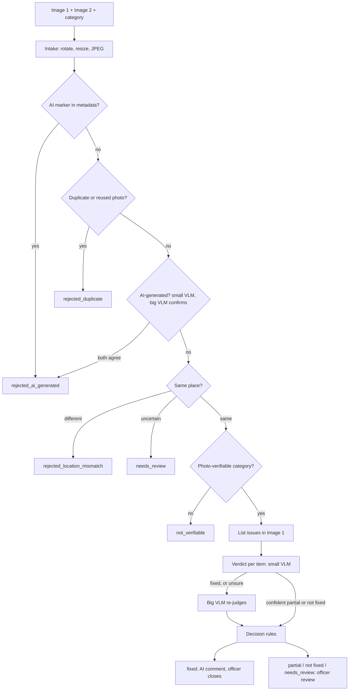
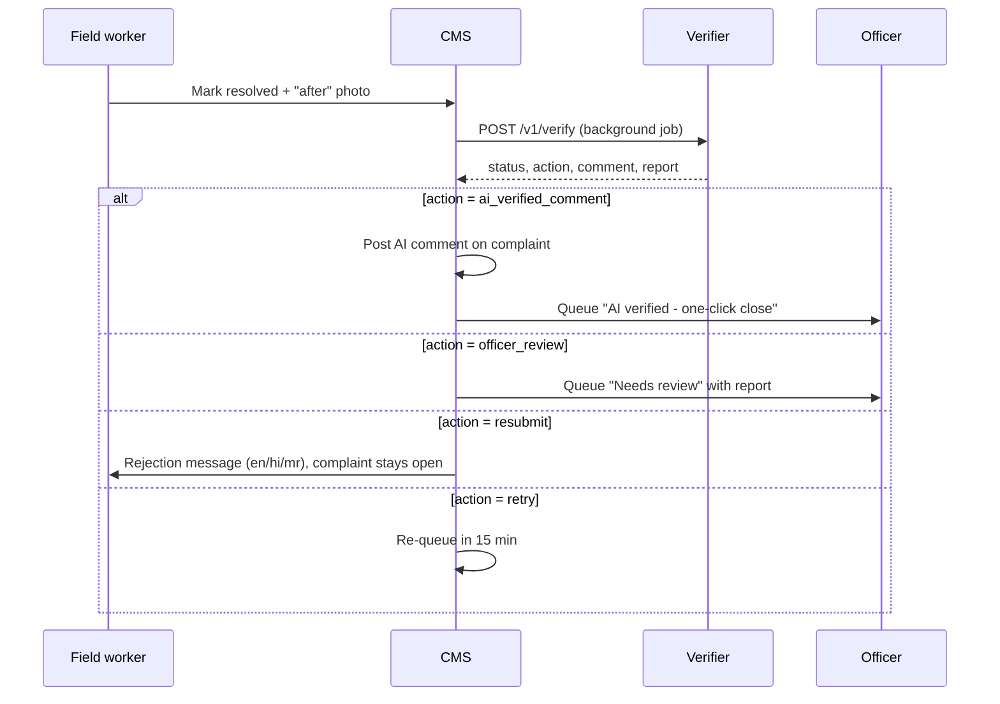

# Complaint Resolution Verifier — PMC "Is it fixed?" check

A service that compares a citizen's **complaint photo (Image 1)** with the **"work done" photo (Image 2)** and decides whether the issue is **fixed, partially fixed or not fixed**. It writes a short report of what was fixed in **English, Hindi and Marathi**. It also **rejects AI-generated, reused or wrong-location photos**. All model calls go to **Ollama Cloud**; the rest is plain Python in a FastAPI service.

Today resolved complaints are only spot-checked. This checks every resolved complaint. In v1 **the AI never closes a complaint**: on "fixed" it posts a "Verified resolved by AI reviewer" comment and an officer closes it.

Plan agreed on 23 Oct 2026.

## Decisions

| Area | Decision |
|---|---|
| Images | CCTV or mobile, always the same place. Image 2 can come from **any upload or WhatsApp**, so metadata is often stripped. |
| Categories | **84 categories**, each mapped to one of 4 verification types in `config/categories.yaml` |
| Verdicts | `fixed` / `partially_fixed` / `not_fixed`, plus `not_verifiable`, `needs_review`, three rejection states and `error` |
| AI-generated photos | **Always auto-reject**, but only when **2 models agree**. Applies to Image 1 too: an AI-generated complaint photo rejects the whole verification. |
| Compute | **Ollama Cloud only** for models. Light Python (EXIF, perceptual hash) runs in the service. |
| Model use | **Cascade: small VLM first, big VLM when unsure** |
| On "fixed" (v1) | AI posts a comment with a short reason in en/hi/mr; **an officer closes the complaint** |
| Auto-close (later) | **Category by category.** Per-category flag, off by default, turned on only after that category meets its accuracy target. |
| Not fixed / partial / needs_review | Officer review |
| Non-visual categories (billing, noise, …) | `not_verifiable`. The AI and same-place checks still run. |
| Duplicate photos | Perceptual hash of **every past submission** in SQLite (Postgres later) |
| Packaging | FastAPI microservice |
| Volume | ~100 complaints/day, ~70 resolved/day. Minutes per result is fine (async). |
| Licence / privacy | Internal / research. Sending photos to Ollama Cloud is accepted. |

---

## 1. Architecture

### Why a VLM judge and not a detector

| | A: Open-vocabulary detector (Grounding DINO-T, OWLv2) | B: VLM judge (chosen) |
|---|---|---|
| Runs on | Local GPU or CPU | Ollama Cloud |
| Hallucination risk | Low: boxes and scores | Higher. Controlled with JSON schemas, evidence rules, two-model agreement and code-side rules. |
| Understands "fixed" | No. Only "object present / absent". Can't judge a patched road or a working light. | Yes. A per-type rubric covers removal, repair and state change. |
| Same-place check | Needs separate feature matching | Compares landmarks directly |
| Fit with "Ollama Cloud only" | **Not possible.** Ollama serves only LLMs and VLMs. | Fits |

The weak form of B (stitch both photos and ask a 2–3B model) is not used. Instead:
- the two photos go **as two separate images in one request**, so each keeps full resolution
- each stage has a narrow prompt and returns **schema-checked JSON**
- every claim needs visible evidence
- the small and big models must agree before anything is rejected or marked fixed
- Python makes the final decision

A local detector can be added later for counting-heavy categories, if local compute becomes available.

### Models (confirm on ollama.com before Phase 1)

| Role | Model | Used for |
|---|---|---|
| Big VLM | `qwen3-vl:235b-cloud` | Confirmations, and any step where the small model is unsure |
| Small VLM | To confirm: `gemma4:31b` or a smaller `qwen3-vl` cloud tag | First pass on every visual step |
| Small text model | To confirm (e.g. `gpt-oss:20b-cloud`) | Translating report lines to Hindi and Marathi |

Client: `ollama.Client(host="https://ollama.com", headers={"Authorization": "Bearer <OLLAMA_API_KEY>"})`, then `chat(..., format=<JSON schema>, options={"temperature": 0})`.

### Flow



### Stages (stop at the first rejection)

| # | Stage | Runs on | Outcome |
|---|---|---|---|
| 1 | **Intake.** Decode (HEIC too), fix rotation from EXIF, resize to a 1536 px long edge, re-encode as JPEG. Original bytes kept for forensics. | Python | `error` if unreadable |
| 2 | **Forensics.** AI-generator markers in EXIF or PNG text chunks (optional C2PA). Perceptual hash: Image 2 ≈ Image 1, or Image 2 matches a photo from another complaint. | Python | `rejected_ai_generated` / `rejected_duplicate` |
| 3 | **AI-generated check**, one call per image. Big model re-checks when the small model flags an image or isn't confident. | Small → big VLM | `rejected_ai_generated` only if **both** say AI with named indicators. A disagreement becomes a soft flag, so no AI comment. |
| 4 | **Same place?** Must list landmarks matched in both photos (buildings, poles, kerbs, signboards). "Same" needs at least 2. | Small → big VLM | `rejected_location_mismatch` / `needs_review` |
| 5 | **Category lookup** | Config | `not_verifiable` |
| 6 | **Describe issues in Image 1** as numbered items (e.g. 3 garbage piles) | Small → big VLM | `needs_review` if no issue is visible |
| 7 | **Verdict per item:** fixed / partial / not fixed / cannot determine, each with visible evidence. No evidence = not fixed. Also reports whether the issue area is visible in Image 2. | Small VLM | — |
| 8 | **Cascade confirmation.** A small-model "fixed" is always re-judged by the big model. If they disagree → `needs_review`. | Big VLM | — |
| 9 | **Decision rules** | Python | `ai_verified_comment` / `auto_close` (if the category flag is on) / `officer_review` / `resubmit` / `retry` |
| 10 | **Comment and report.** Fixed templates in en/hi/mr. Only item lines are translated, by the small text model, with no facts added. | Python + text model | — |

**A technical failure is never a rejection.** Timeouts or bad JSON after retries give `error` → `retry`.

### Cascade triggers

| Trigger | What the big model does |
|---|---|
| Small model's verdict is `fixed` | Re-judges it. "Fixed" stands only if both agree; otherwise `needs_review`. |
| Small model flags an image as AI-generated | Re-checks it. Reject only if both agree. |
| Any small-model step returns low or medium confidence | Re-runs the step. The big model's answer is used. |
| Same-place returns `uncertain` | Re-runs it. Still uncertain → `needs_review`. |

### Verification types

Each of the 84 categories is one row in `config/categories.yaml`:

| Type | Examples | What "fixed" means | Notes |
|---|---|---|---|
| `removal` | garbage, debris, dead animal, encroachment | The item is gone. Partial = some remains, or it was only pushed aside. | Count items in Image 1 |
| `repair` | pothole, broken footpath, drain cover | Surface or structure restored; a fresh patch counts | Different-looking material is fine |
| `state_change` | streetlight, traffic signal, water leak | Working / ON / stopped | `requires_night_photo: true` for lights. A day photo gives `cannot_determine` → review. |
| `not_photo_verifiable` | billing, noise, staff behaviour | — | → `not_verifiable` |

Mapping template (fill in for all 84):

```yaml
- id: "GARBAGE_NOT_LIFTED"
  name_en: "Garbage not lifted"
  verification_type: removal
  fixed_criteria: "No garbage left at the spot; ground visible and clear."
  partial_criteria: "Some garbage removed but some still lying, or pushed aside."
  requires_night_photo: false
  auto_close: false
- id: "POTHOLE"
  name_en: "Pothole on road"
  verification_type: repair
  fixed_criteria: "Pothole filled and level with the road; fresh patch is fine."
  partial_criteria: "Partly filled, uneven, or only some potholes filled."
  requires_night_photo: false
  auto_close: false
- id: "STREETLIGHT_NOT_WORKING"
  name_en: "Streetlight not working"
  verification_type: state_change
  fixed_criteria: "The same streetlight is clearly ON at night."
  partial_criteria: "Some of the reported lights are ON, others still off."
  requires_night_photo: true
  auto_close: false
- id: "WATER_BILL_ISSUE"
  name_en: "Water bill issue"
  verification_type: not_photo_verifiable
  requires_night_photo: false
  auto_close: false
```

How to map a category: ask "what would a photo of the *fixed* state show?"
- **Nothing should be there any more** → `removal`
- **Something broken is now whole** → `repair`
- **Something off is now on, or running is now stopped** → `state_change`
- **A photo can't show it** → `not_photo_verifiable`

If a category could fit two types, pick the one whose "fixed" photo an officer would accept. Write `fixed_criteria` in one plain sentence an officer would agree with.

### Stage-by-stage detail

| # | Stage | Input | Output | Escalates to big model when | Calls (small / big) |
|---|---|---|---|---|---|
| 1 | Intake | Raw bytes of both photos | `PreparedImage` (original, JPEG at 1536 px, PIL image) | — | 0 / 0 |
| 2 | Forensics | Original bytes, PIL images | Metadata markers; `pair_distance`; nearest past photo + distance | — | 0 / 0 |
| 3 | AI check | One JPEG per call | `AICheck`: `ai_generated`, `confidence`, `indicators[]` | Small flags AI (with indicators), or confidence < high | 2 / 0–2 |
| 4 | Same place | Both JPEGs | `SamePlace`: `verdict`, `confidence`, `landmarks[]`, `reason` | Verdict `uncertain`, or confidence < high | 1 / 0–1 |
| 5 | Category lookup | `category_id` | `Category` row | — | 0 / 0 |
| 6 | Describe issue | Image 1 JPEG + category | `IssueList`: `issue_visible`, `items[]` with boxes | Confidence < high | 1 / 0–1 |
| 7–8 | Verdict + confirmation | Both JPEGs + rubric + item list | `Verdict`: `overall`, per-item status + evidence, `issue_area_visible`, `remaining_problems[]` | Small says `fixed`, or confidence < high | 1 / 0–1 |
| 9 | Decision | Status, same-place, soft flags, category flag | `Action` | — | 0 / 0 |
| 10 | Comment + report | Status, items, landmarks | `comment` and `report` in en/hi/mr | — | text model: 0–1 |

**Per verification:** 5 small-VLM calls at most, 0–5 big-VLM calls, and 0–1 text-model calls. Rejections and `needs_review` use templates only, so there's no text-model call.

**Soft flags** are reasons that block an `ai_verified_comment` without rejecting:
- `ai_models_disagree_image1/2`: the small and big models disagreed on whether a photo is AI-generated

More can be added later (e.g. EXIF GPS too far from the complaint address, EXIF time before the complaint time).

### Settings and thresholds

| Setting | Default | What it does | How to tune |
|---|---|---|---|
| `big_model` | `qwen3-vl:235b-cloud` | Confirmation model | Change only after re-running the golden set |
| `small_model` | `gemma4:31b-cloud` (to confirm) | First-pass model | Pick the cheapest model whose escalation rate stays under ~50% |
| `text_model` | `gpt-oss:20b-cloud` (to confirm) | Hindi/Marathi item lines | Native-speaker spot check |
| `max_side` | 1536 px | Long edge sent to the VLM (~1,700 tokens per image) | Drop to 1024 px (~770 tokens) if small details still read fine on the golden set |
| `phash_max_distance` | 8 (of 64 bits) | At or below this = "same photo" | Measure on ~50 WhatsApp-recompressed pairs. It must catch re-sent photos but not two genuinely different photos of one spot. |
| Minimum landmarks for "same" | 2 | Fewer → treated as `uncertain` | Raise to 3 if wrong-location photos slip through |
| Escalation confidence | anything below `high` | When the big model is called | Keep. This is the safety net. |
| Retries per model call | 3, backoff 2–20 s | Network or JSON failures | — |
| Model call timeout | 120 s | Per call | — |
| `temperature` | 0 | Repeatable answers | — |
| Max upload size | 10 MB per photo | Rejects huge files with HTTP 413 | — |

---

## 2. Edge cases

| Case | Handling |
|---|---|
| Camera shifted, different device, zoom, lighting, day vs night | No image registration needed. The same-place stage compares permanent landmarks. |
| Image 2 cropped tight to hide what's left | Verdict reports `issue_area_visible`. If false → `needs_review`. |
| Issue moved, not removed (garbage pushed aside) | Item marked `partial` with a "moved" note |
| Several instances (3 piles → 1 left) | Per-item statuses → `partially_fixed`, with counts in the report |
| Spot blocked by a vehicle or person | `cannot_determine` → `needs_review` |
| Streetlight photographed in daytime | `cannot_determine` → `needs_review` |
| Same photo resubmitted, or an old photo reused | Perceptual hash → `rejected_duplicate` |
| Clean photo of a different street | Landmark mismatch → `rejected_location_mismatch` |

**Known limitation:** AI detection relies only on VLMs plus metadata, and WhatsApp strips metadata. Two-model agreement reduces false rejections, but some genuine photos will still be rejected. Log every rejection and track the false-reject rate.

---

## 3. Worked examples

**Example 1. Garbage, 3 piles, 1 left behind**

| Stage | What happens |
|---|---|
| Forensics | No markers. Pair distance 30, nearest past photo 26. Both are above 8, so not a duplicate. |
| AI check | Small model: both photos clean, high confidence. No escalation. |
| Same place | Small model: `same`, high, landmarks "blue gate, electric pole, Shree Medical board" |
| Describe issue | 3 items: pile by the gate, pile at the pole, bags near the shop |
| Verdict | Small model: `partially_fixed`, high. Items 1 and 2 fixed; item 3 not fixed ("bags still visible below the shop board"). No escalation, because the verdict isn't "fixed". |
| Decision | `partially_fixed` → `officer_review` |
| Comment (en) | "AI reviewer: partly fixed. Officer check needed. 2 of 3 items fixed. Same location confirmed: blue gate, electric pole, Shree Medical board." |
| Calls | 5 small + 1 text |

**Example 2. Garbage fully cleared**

| Stage | What happens |
|---|---|
| AI, same place, describe | As above. 2 items. |
| Verdict | Small model: `fixed` → **always escalates**. Big model: `fixed`, both items fixed with evidence. |
| Decision | Same place is high and there are no soft flags → `ai_verified_comment` |
| CMS | Posts "Verified resolved by AI reviewer. 2 of 2 items fixed. Same location confirmed: …" in en/hi/mr. The officer closes it with one click. |
| Calls | 5 small + 1 big + 1 text |

**Example 3. Streetlight, "after" photo taken in daytime**

| Stage | What happens |
|---|---|
| Category | `state_change`, `requires_night_photo: true`. The night rule is added to the verdict prompt. |
| Verdict | Small model: `cannot_determine` ("daytime photo, light state not visible") |
| Decision | `needs_review` → `officer_review`. The officer can ask for a night photo. |
| Calls | 5 small, plus 1 big only if the small model wasn't confident |

**Example 4. Recycled "after" photo**

| Stage | What happens |
|---|---|
| Forensics | Image 2 matches a photo already submitted for complaint PMC-2026-099812 (distance 3, below 8) |
| Result | `rejected_duplicate` → `resubmit`, with the template message in en/hi/mr |
| Calls | **0 model calls, ₹0** |

**Example 5. AI-generated "after" photo**

| Stage | What happens |
|---|---|
| AI check, Image 2 | Small model: AI, indicators "warped shop-board text, melted kerb edge" → escalates. Big model: AI, with indicators. **Both agree.** |
| Result | `rejected_ai_generated` → `resubmit` |
| Calls | 2 small + 1 big |

If the big model had said "not AI", the photo would carry on with the soft flag `ai_models_disagree_image2`. Even a "fixed" result would then go to `officer_review`.

---

## 4. Cost exploration

**Assumptions:**
- ₹88 = $1.
- Ollama's own per-token rate for `qwen3-vl` is unconfirmed, so prices use OpenRouter's rate for `qwen3-vl-235b-a22b-instruct` as a stand-in. Worst case is **$0.20/M input, $1.90/M output**.
- About **1,700 tokens per image** at 1536 px (Qwen3-VL: 1 token per 32×32 px).
- **Ollama Cloud Pro: $20/month**, includes **$60 of usage credits**, 3 concurrent requests.

### A. Fixed monthly cost

| Item | ₹ / month |
|---|---|
| Ollama Cloud Pro ($20, includes $60 credits) | ₹1,760 |
| FastAPI server | ₹0 on an existing server, or ₹500–1,500 for a small VM |
| Storage (hashes, logs, ~1.5 GB/month if image copies are kept) | ~₹0 |
| **Fixed total** | **₹1,760 – 3,260** |

### B. Variable cost per verification

Baseline design: big model only, 3 verdict runs. This is an upper bound before the reductions in E.

| Step | Tokens in / out | $ | ₹ | Share |
|---|---|---|---|---|
| AI check, Image 1 | 2.3k / 0.3k | 0.0010 | 0.09 | 7% |
| AI check, Image 2 | 2.3k / 0.3k | 0.0010 | 0.09 | 7% |
| Same-place check | 4.2k / 0.4k | 0.0016 | 0.14 | 11% |
| Describe issues, Image 1 | 2.3k / 0.4k | 0.0012 | 0.11 | 8% |
| Verdict ×3 runs | 13.5k / 1.8k | 0.0061 | 0.54 | 40% |
| Report en + hi + mr | 2k / 2k | 0.0042 | 0.37 | 28% |
| **Full run** | **27k / 5k** | **0.0152** | **1.34** | 100% |

Cost by outcome, because the pipeline stops early:

| Outcome | ₹ |
|---|---|
| Rejected in Python (duplicate or AI metadata) | 0.37 |
| Rejected as AI-generated by the VLM | 0.46–0.55 |
| Location mismatch, or `not_verifiable` | 0.69 |
| Full verdict | 1.34 |

**Monthly:**
- Volume: 70/day × 30 = **2,100 resolved complaints**, about **2,500 runs** including ~20% resubmits.
- Usage, worst case (every run full path): **$38 (₹3,350)**. That's inside the $60 Pro credits, so **no extra charge**.
- Usage passes the credits above about **3,900 full runs/month** (≈1.9× today).
- Throughput: ~1.5 min per verification, ~2 hours of processing a day, well within 3 concurrent requests.

### C. One-time cost

| Item | Effort / cost |
|---|---|
| Build MVP (pipeline, API, tests) | ~3–4 engineer-weeks (estimate) |
| Map 84 categories to 4 types | ~1 day with a domain person |
| Golden set: label ~250 real pairs | ~5–8 officer-hours |
| Prompt tuning (250 pairs × ~10 iterations) | ~$38 of usage, covered by credits |

### D. People cost (the main lever)

In v1 an officer touches every result: a **one-click close** on AI-verified "fixed", and a **full review** for not fixed, partial and needs_review.

| Share needing full review | Reviews / month | Officer time (2 min each) |
|---|---|---|
| 10% | 210 | ~7 h |
| 30% | 630 | ~21 h |
| 50% | 1,050 | ~35 h |

Other non-cash costs:
- A wrong AI rejection means a resubmission and another run.
- A wrong "verified resolved" comment that an officer accepts means a reopened complaint and an unhappy citizen. **This is the most expensive error.**

### E. Reductions

| Lever | Status | Effect |
|---|---|---|
| Cascade: small first, big when unsure | **Chosen** | Every "fixed" escalates, so the saving depends on the escalation rate: ~20–35% at 50–60% escalation (estimate, to be measured) |
| AI reject needs 2 models to agree | **Chosen** | Fewer false rejections; the second call happens only when the first model flags the image |
| Small + big agreement replaces 3 verdict runs | **Chosen** | Removes most of the 40% verdict cost |
| Templated en/hi/mr comment and report; only item lines translated | **Chosen** (in the skeleton) | Removes most of the 28% report cost. Rejections need no LLM call at all. |
| Officer review screen (side-by-side photos + reasons, one-click close) | Proposed | ~2 min → ~30 s per review |
| Per-category auto-close rollout | **Chosen** | Officer load falls as categories prove accurate |
| Pay-as-you-go instead of Pro | Revisit after measuring | Token cuts save ₹0 on Pro, because usage is under the $60 credits |

**Summary:** cash cost is about **₹1,760–3,260/month** and essentially flat. The real cost levers are **officer time and wrong verdicts**.

With templated texts, Python rejections (Example 4) cost **₹0**, not the ₹0.37 in table B, which assumed an LLM-written report.

### F. Calls per verification with the cascade

| Outcome | Small VLM | Big VLM | Text model |
|---|---|---|---|
| Rejected in Python | 0 | 0 | 0 |
| Rejected as AI-generated | 1–2 | 1–2 | 0 |
| Location mismatch / `not_verifiable` | 3 | 0–3 | 0 |
| Partial / not fixed, small model confident | 5 | 0 | 1 |
| Fixed (always confirmed) | 5 | 1+ | 1 |

Real ₹ per verification = small calls × small rate + big calls × big rate + text call. Measure it in Phase 5 from the token counts Ollama returns (`prompt_eval_count`, `eval_count`).

---

## 5. CMS integration and officer review

### API

| | |
|---|---|
| Endpoint | `POST /v1/verify` (multipart form) |
| Fields | `complaint_id` (text), `category_id` (text), `image1` (complaint photo), `image2` (work-done photo) |
| Auth | `X-API-Key` header with a service key shared only with the CMS |
| Limits | 10 MB per photo. JPEG, PNG, HEIC, WebP. |
| Responses | `200` with the JSON contract (section 8); `400` unknown category; `401` bad key; `413` file too large |
| Health | `GET /health` |
| Speed | ~1–2 min per call. The CMS should call it from a background job, not while a user waits. |

### Flow



### What the CMS does for each action

| Action | CMS behaviour | Limits |
|---|---|---|
| `ai_verified_comment` | Post `comment` on the complaint, then add it to the officer's "AI verified" queue | The officer closes it with one click |
| `auto_close` | Close the complaint and post `comment` | Only for categories with `auto_close: true` (none in v1) |
| `officer_review` | Add to the "Needs review" queue with `report` and both photos | — |
| `resubmit` | Send the rejection `comment` to the worker; the complaint stays open | **After 3 rejections on one complaint → officer review**, so there are no endless loops |
| `retry` | Re-run the verification after 15 min | **After 3 failed retries → officer review** |

### Officer review screen

| Element | Detail |
|---|---|
| Photos | Image 1 and Image 2 side by side, with item boxes drawn from `bbox_image1` / `bbox_image2` |
| Verdict panel | Status, per-item status with evidence, matched landmarks, soft flags |
| Language | Officer picks en / hi / mr |
| Buttons | **Close** (agree) · **Reopen to worker** (with a note) · **Override** (pick the correct status and give a reason) |
| Target | ~30 s per review, down from ~2 min |
| Logging | Every officer decision is stored next to the AI's verdict. Overrides become new golden-set examples. |

---

## 6. Operations

### Error handling

| Failure | Where | Result |
|---|---|---|
| Photo can't be decoded | Intake | `error` → `retry`. If it fails again, the CMS asks the worker to re-upload. |
| Ollama timeout, 5xx, network | Any model call | 3 retries with backoff, then `error` → `retry` |
| Model returns JSON that fails the schema | Any model call | Counted as a failure and retried |
| Ollama credits used up, or rate limit hit | Any model call | `error` → `retry`, and an alert |
| Translation fails | Report | English lines used for hi/mr; the verification still completes |
| Unknown `category_id` | API | HTTP 400 |

### Logging (one row per verification, SQLite `verifications` table)

`complaint_id`, attempt number, timestamp, status, action, soft flags, every step's small and big answers, escalated steps, latency per call, and token counts per call (`prompt_eval_count`, `eval_count`). The officer's final decision is added later. This table drives the metrics and the golden set.

### Monitoring and alerts

| Metric | Alert when |
|---|---|
| `error` rate | > 5% in a day |
| Ollama credit usage | > 80% of the month's $60 |
| Escalation rate | > 60% (cost rising, small model weak) |
| `needs_review` rate | > 40% (officer load) |
| AI-rejection rate | Sudden jump (false rejections, or a new fraud pattern) |
| p95 time per verification | > 5 min |
| Officer override rate on `ai_verified_comment` | > 5% for a category (that category's accuracy is slipping) |

### Security and data

- `OLLAMA_API_KEY` and the service API key are kept in environment variables or a secret store, never in git.
- The service stores **only hashes and the verification log** by default. Photos stay in the CMS. Keeping image copies for audit is optional, and how long to keep them is a policy decision (open item).
- Photos are sent to Ollama Cloud. This was accepted in discussion.
- The verifier is reachable only from the CMS network, behind the API key.

---

## 7. Implementation phases (task breakdown)

**Total ≈ 20 working days (~4 weeks) for one engineer**, plus officer time for labelling.

### Phase 1: Setup (2 days)

| Task | Done when |
|---|---|
| Create the repo with the layout in section 9, a venv and `requirements.txt` | `pytest` runs |
| Get the Ollama Cloud API key, put it in `.env`, buy Pro | — |
| List the cloud models and confirm the big, small and text tags; note each one's per-token rate | Tags written into `Settings` |
| Smoke test: one `chat_json` call with an image and a schema | Valid JSON comes back |

### Phase 2: Preprocessing and forensics (3 days)

| Task | Done when |
|---|---|
| `prepare()` handles JPEG, PNG, HEIC and WebP, plus rotated phone photos | Tests on sample files pass |
| `metadata_markers()` | Catches a Stable Diffusion PNG with `parameters`, and a JPEG with a generator in `Software`. Passes a normal phone photo and a WhatsApp photo. |
| `HashStore` with nearest-match search | Re-sent photo caught; different photo passes |
| Tune `phash_max_distance` on ~50 WhatsApp-recompressed pairs | Threshold chosen and written down |

### Phase 3: Core inference (6 days)

| Task | Done when |
|---|---|
| Schemas and prompts for all stages | — |
| `OllamaVLM`, `Cascade`, `checks.py`, `decision.py`, `pipeline.py` | — |
| Mocked-VLM tests for every branch: each rejection, disagreement → soft flag, small "fixed" vs big "not fixed" → `needs_review`, `not_verifiable`, `error` | All branches covered |
| Run 20 real pairs end-to-end and read every answer | Prompts adjusted where the answers are wrong |

### Phase 4: Service and integration (4 days)

| Task | Done when |
|---|---|
| FastAPI endpoint with API key, upload limit and error codes | curl test passes |
| `verifications` log table, including token counts | Rows written per call |
| Native speakers review the Hindi and Marathi templates | Templates signed off |
| CMS hook: call from a background job, act on each action, retry and resubmit limits | A test complaint gets the AI comment in CMS |
| Officer review screen (or a list view in the CMS admin to start) | An officer can close, reopen and override |

### Phase 5: Evaluation and rollout (5 days + ongoing)

| Task | Done when |
|---|---|
| Collect and label the golden set (~250) and adversarial set (~50), following section 10 | Labels complete |
| Run both sets; compute metrics per category; tune prompts and thresholds | Metrics report written |
| Launch in comment-only mode for all categories | Live |
| Weekly review of AI vs officer decisions | Ongoing |
| Turn on `auto_close` per category as each meets its target | Ongoing |

---

## 8. JSON output contract

```json
{
  "complaint_id": "PMC-2026-104233",
  "category_id": "GARBAGE_NOT_LIFTED",
  "verification_type": "removal",
  "status": "fixed",
  "action": "ai_verified_comment",
  "comment": {
    "en": "Verified resolved by AI reviewer. 2 of 2 items fixed. Same location confirmed: blue gate, electric pole.",
    "hi": "AI समीक्षक द्वारा सत्यापित: समस्या हल हो गई है। 2 में से 2 काम पूरे। वही जगह पक्की: नीला गेट, बिजली का खंभा।",
    "mr": "AI तपासणीत खात्री झाली: तक्रार सोडवली आहे. 2 पैकी 2 कामे पूर्ण. तीच जागा नक्की: निळे गेट, विजेचा खांब."
  },
  "report": {"en": "…", "hi": "…", "mr": "…"},
  "checks": {
    "metadata": {"image1": [], "image2": []},
    "duplicate": {"pair_distance": 31, "nearest_other": ["PMC-2026-099812", 24]},
    "ai_generated": {"image1": {"outcome": "clean"}, "image2": {"outcome": "clean"}},
    "same_place": {"verdict": "same", "confidence": "high", "landmarks": ["blue gate", "electric pole"]}
  },
  "items": [
    {"id": 1, "description": "Garbage pile next to blue gate", "status": "fixed",
     "evidence": "Ground next to the gate is clear", "bbox_image1": [120, 540, 410, 880], "bbox_image2": null},
    {"id": 2, "description": "Plastic bags near pole", "status": "fixed",
     "evidence": "No bags visible at the pole base", "bbox_image1": [610, 700, 760, 900], "bbox_image2": null}
  ],
  "soft_flags": [],
  "cascade": {"escalated_steps": ["verdict"], "steps": {}},
  "models": {"small": "<small-vlm>", "big": "qwen3-vl:235b-cloud", "text": "<text-model>"},
  "pipeline_version": "0.1.0"
}
```

| `status` | `action` |
|---|---|
| `fixed` + same place (high confidence) + no soft flags | `ai_verified_comment` (or `auto_close` if the category flag is on) |
| `fixed` with any doubt, `partially_fixed`, `not_fixed`, `needs_review`, `not_verifiable` | `officer_review` |
| `rejected_ai_generated`, `rejected_duplicate`, `rejected_location_mismatch` | `resubmit` |
| `error` | `retry` |

---

## 9. Starter code skeleton

Layout:

```
resolution_verifier/
  app/
    __init__.py
    config.py       settings + category loader
    schemas.py      enums, VLM output schemas, API response
    preprocess.py   intake
    forensics.py    metadata markers, perceptual hash store
    vlm.py          Ollama Cloud client returning validated JSON
    cascade.py      small model first, big model on triggers
    prompts.py      one prompt per stage
    checks.py       stage functions + escalation rules
    decision.py     status -> action rules
    report.py       en/hi/mr templates + translation of item lines
    pipeline.py     ResolutionVerifier
    main.py         FastAPI
  config/categories.yaml
  tests/test_decision.py
  requirements.txt
```

#### requirements.txt

```text
fastapi
uvicorn[standard]
python-multipart
pydantic>=2
pydantic-settings
ollama>=0.4
pillow
pillow-heif
imagehash
pyyaml
tenacity
pytest
# optional: c2pa-python  (content-credential check)
```

#### app/config.py

```python
from pathlib import Path
from typing import Literal

import yaml
from pydantic import BaseModel
from pydantic_settings import BaseSettings, SettingsConfigDict


class Settings(BaseSettings):
    model_config = SettingsConfigDict(env_file=".env")

    ollama_host: str = "https://ollama.com"
    ollama_api_key: str = ""                  # env: OLLAMA_API_KEY
    service_api_key: str = ""                 # env: SERVICE_API_KEY, shared with the CMS only
    big_model: str = "qwen3-vl:235b-cloud"
    small_model: str = "gemma4:31b-cloud"     # confirm the tag on ollama.com
    text_model: str = "gpt-oss:20b-cloud"     # confirm the tag on ollama.com
    max_side: int = 1536                      # long edge sent to the VLM
    phash_max_distance: int = 8               # <= this = same photo; tune on real data
    db_path: str = "verifier.db"
    categories_path: str = "config/categories.yaml"


VerificationType = Literal["removal", "repair", "state_change", "not_photo_verifiable"]


class Category(BaseModel):
    id: str
    name_en: str
    verification_type: VerificationType
    fixed_criteria: str = ""
    partial_criteria: str = ""
    requires_night_photo: bool = False
    auto_close: bool = False                  # off until the category proves accurate


def load_categories(path: str) -> dict[str, Category]:
    rows = yaml.safe_load(Path(path).read_text(encoding="utf-8"))
    return {row["id"]: Category(**row) for row in rows}
```

#### app/schemas.py

```python
from enum import Enum
from typing import Any, Literal

from pydantic import BaseModel, Field

Confidence = Literal["low", "medium", "high"]


class Status(str, Enum):
    FIXED = "fixed"
    PARTIALLY_FIXED = "partially_fixed"
    NOT_FIXED = "not_fixed"
    NOT_VERIFIABLE = "not_verifiable"
    NEEDS_REVIEW = "needs_review"
    REJECTED_AI_GENERATED = "rejected_ai_generated"
    REJECTED_DUPLICATE = "rejected_duplicate"
    REJECTED_LOCATION_MISMATCH = "rejected_location_mismatch"
    ERROR = "error"


REJECTED = {Status.REJECTED_AI_GENERATED, Status.REJECTED_DUPLICATE, Status.REJECTED_LOCATION_MISMATCH}


class Action(str, Enum):
    AI_VERIFIED_COMMENT = "ai_verified_comment"
    AUTO_CLOSE = "auto_close"
    OFFICER_REVIEW = "officer_review"
    RESUBMIT = "resubmit"
    RETRY = "retry"


# --- What the VLM must return at each stage (sent as the `format=` JSON schema) ---

class AICheck(BaseModel):
    ai_generated: bool
    confidence: Confidence
    indicators: list[str] = Field(default_factory=list)


class SamePlace(BaseModel):
    verdict: Literal["same", "different", "uncertain"]
    confidence: Confidence
    landmarks: list[str] = Field(default_factory=list)
    reason: str = ""


class IssueItem(BaseModel):
    id: int
    description: str
    bbox: list[int] | None = None             # [x1, y1, x2, y2], 0-1000 scale


class IssueList(BaseModel):
    issue_visible: bool
    confidence: Confidence
    items: list[IssueItem] = Field(default_factory=list)


class ItemVerdict(BaseModel):
    id: int
    status: Literal["fixed", "partial", "not_fixed", "cannot_determine"]
    evidence: str
    bbox: list[int] | None = None


class Verdict(BaseModel):
    overall: Literal["fixed", "partially_fixed", "not_fixed", "cannot_determine"]
    confidence: Confidence
    issue_area_visible: bool
    items: list[ItemVerdict] = Field(default_factory=list)
    remaining_problems: list[str] = Field(default_factory=list)


class Translation(BaseModel):
    hi: list[str]
    mr: list[str]


# --- API response ---

class ItemOut(BaseModel):
    id: int
    description: str
    status: str | None = None
    evidence: str = ""
    bbox_image1: list[int] | None = None
    bbox_image2: list[int] | None = None


class VerificationResult(BaseModel):
    complaint_id: str
    category_id: str
    verification_type: str
    status: Status
    action: Action
    comment: dict[str, str]
    report: dict[str, str]
    checks: dict[str, Any]
    items: list[ItemOut]
    soft_flags: list[str]
    cascade: dict[str, Any]
    models: dict[str, str]
    pipeline_version: str
```

#### app/preprocess.py

```python
import io
from dataclasses import dataclass

from PIL import Image, ImageOps
from pillow_heif import register_heif_opener

register_heif_opener()                        # iPhone HEIC uploads


@dataclass
class PreparedImage:
    original: bytes                           # untouched, for forensics
    jpeg: bytes                               # what the VLM sees
    image: Image.Image                        # for hashing


def prepare(data: bytes, max_side: int) -> PreparedImage:
    img = Image.open(io.BytesIO(data))
    img = ImageOps.exif_transpose(img).convert("RGB")
    img.thumbnail((max_side, max_side))
    buf = io.BytesIO()
    img.save(buf, format="JPEG", quality=90)
    return PreparedImage(original=data, jpeg=buf.getvalue(), image=img)
```

#### app/forensics.py

```python
import io
import sqlite3
from datetime import datetime, timezone

import imagehash
from PIL import Image

AI_MARKERS = (
    "stable diffusion", "midjourney", "dall-e", "dall·e", "firefly", "imagen",
    "comfyui", "automatic1111", "novelai", "leonardo.ai", "ideogram",
)
EXIF_TEXT_TAGS = (0x0131, 0x010E, 0x013B)     # Software, ImageDescription, Artist
PNG_GENERATOR_KEYS = ("parameters", "prompt", "workflow")


def metadata_markers(data: bytes) -> list[str]:
    """Hard evidence of an AI generator in the file's metadata. Empty list = nothing found."""
    img = Image.open(io.BytesIO(data))
    found: list[str] = []
    exif = img.getexif()
    for tag in EXIF_TEXT_TAGS:
        value = str(exif.get(tag, "")).lower()
        found += [m for m in AI_MARKERS if m in value]
    for key, value in (img.info or {}).items():   # PNG text chunks
        if key.lower() in PNG_GENERATOR_KEYS:
            found.append(f"png:{key}")
        elif isinstance(value, str):
            found += [m for m in AI_MARKERS if m in value.lower()]
    return sorted(set(found))


def phash(img: Image.Image) -> imagehash.ImageHash:
    return imagehash.phash(img)


class HashStore:
    """Perceptual hashes of every submitted photo. A linear scan is fine at ~30k photos a year."""

    def __init__(self, path: str):
        self.db = sqlite3.connect(path, check_same_thread=False)
        self.db.execute(
            "CREATE TABLE IF NOT EXISTS hashes ("
            " complaint_id TEXT, role TEXT, phash TEXT, created_at TEXT,"
            " UNIQUE(complaint_id, role, phash))"
        )

    def nearest(self, h: imagehash.ImageHash, exclude_complaint: str) -> tuple[str, int] | None:
        best: tuple[str, int] | None = None
        rows = self.db.execute(
            "SELECT complaint_id, phash FROM hashes WHERE complaint_id != ?", (exclude_complaint,)
        )
        for complaint_id, hex_hash in rows:
            distance = int(h - imagehash.hex_to_hash(hex_hash))
            if best is None or distance < best[1]:
                best = (complaint_id, distance)
        return best

    def add(self, complaint_id: str, role: str, h: imagehash.ImageHash) -> None:
        self.db.execute(
            "INSERT OR IGNORE INTO hashes VALUES (?, ?, ?, ?)",
            (complaint_id, role, str(h), datetime.now(timezone.utc).isoformat()),
        )
        self.db.commit()
```

#### app/vlm.py

```python
from typing import TypeVar

from ollama import Client
from pydantic import BaseModel
from tenacity import retry, stop_after_attempt, wait_exponential

T = TypeVar("T", bound=BaseModel)


class VLMError(Exception):
    """Technical failure (network, timeout, invalid JSON after retries). Never a rejection."""


class OllamaVLM:
    def __init__(self, host: str, api_key: str, timeout: float = 120.0):
        self.client = Client(host=host, headers={"Authorization": f"Bearer {api_key}"}, timeout=timeout)

    def chat_json(self, model: str, prompt: str, images: list[bytes], schema: type[T]) -> T:
        message: dict = {"role": "user", "content": prompt}
        if images:
            message["images"] = images        # separate images, never stitched

        @retry(stop=stop_after_attempt(3), wait=wait_exponential(min=2, max=20), reraise=True)
        def call() -> T:
            response = self.client.chat(
                model=model,
                messages=[message],
                format=schema.model_json_schema(),
                options={"temperature": 0},
            )
            return schema.model_validate_json(response.message.content)

        try:
            return call()
        except Exception as e:
            raise VLMError(f"{model}: {e}") from e
```

#### app/cascade.py

```python
from dataclasses import dataclass
from typing import Callable, Generic, TypeVar

from pydantic import BaseModel

from .vlm import OllamaVLM

T = TypeVar("T", bound=BaseModel)


@dataclass
class Step(Generic[T]):
    small: T
    big: T | None = None

    @property
    def final(self) -> T:
        return self.big if self.big is not None else self.small

    @property
    def escalated(self) -> bool:
        return self.big is not None

    def log(self) -> dict:
        return {"small": self.small.model_dump(), "big": self.big.model_dump() if self.big else None}


class Cascade:
    """Small model first; the big model runs only when `escalate(small_answer)` is true."""

    def __init__(self, vlm: OllamaVLM, small_model: str, big_model: str):
        self.vlm = vlm
        self.small_model = small_model
        self.big_model = big_model

    def run(self, prompt: str, images: list[bytes], schema: type[T], escalate: Callable[[T], bool]) -> Step[T]:
        small = self.vlm.chat_json(self.small_model, prompt, images, schema)
        if not escalate(small):
            return Step(small=small)
        return Step(small=small, big=self.vlm.chat_json(self.big_model, prompt, images, schema))
```

#### app/prompts.py

```python
import json

from .config import Category
from .schemas import IssueItem

AI_CHECK = """You are a photo forensics reviewer for a municipal complaint system.
Decide whether this photo was generated or heavily edited by AI.
Signs of AI: warped or unreadable text and signboards, impossible geometry, melted or
merged objects, inconsistent shadows or reflections, unnaturally clean textures.
Normal phone processing (HDR, night mode, beauty filters, compression, WhatsApp
re-encoding) is NOT AI-generated.
Set ai_generated=true only if you can list specific indicators you can see."""

SAME_PLACE = """Image 1 is a citizen's complaint photo. Image 2 was submitted later as proof of work.
Decide whether both photos show the same physical place.
Ignore the reported issue itself (garbage, potholes, lights may have changed).
Compare permanent landmarks: buildings, walls, gates, poles, trees, kerbs, road markings,
signboards, shop fronts. Camera angle, zoom, lighting and time of day may differ.
List every landmark you can match in BOTH photos.
verdict=same only if at least two landmarks match; different if the scenes clearly do
not match; otherwise uncertain."""

TYPE_RUBRIC = {
    "removal": ("The reported item is completely gone from the spot.",
                "Some of it was removed but some remains, or it was only moved aside."),
    "repair": ("The damage is repaired; a fresh patch or new material is fine.",
               "Repaired only in part, or the repair is clearly incomplete."),
    "state_change": ("The reported thing now works (light ON, signal working, leak stopped).",
                     "Some of the reported units work, others still do not."),
}

NIGHT_RULE = """This issue is a light that must be ON. If Image 2 is a daytime photo where
you cannot see the light working, the status is cannot_determine."""


def describe_issue(cat: Category) -> str:
    return f"""This is a citizen's complaint photo for the category "{cat.name_en}".
List every separate instance of the reported issue you can see, as numbered items
(for example each separate garbage pile, each pothole, each dark streetlight).
For each give a short description of what it is and where it is in the frame, and a
bounding box [x1, y1, x2, y2] on a 0-1000 scale if you can.
If the reported issue is not visible in the photo, set issue_visible=false."""


def verdict(cat: Category, items: list[IssueItem]) -> str:
    default_fixed, default_partial = TYPE_RUBRIC[cat.verification_type]
    item_list = json.dumps([i.model_dump() for i in items], ensure_ascii=False)
    night = NIGHT_RULE if cat.requires_night_photo else ""
    return f"""Image 1 is the complaint photo. Image 2 is the proof-of-work photo of the same place.
Category: "{cat.name_en}" ({cat.verification_type}).
Counts as fixed: {cat.fixed_criteria or default_fixed}
Counts as partially fixed: {cat.partial_criteria or default_partial}
{night}
Issues listed from Image 1: {item_list}

For each item decide its status in Image 2: fixed, partial, not_fixed or cannot_determine.
Give evidence: the visible detail in Image 2 that supports the status.
If you cannot point to visible evidence, the status is not_fixed.
If the item's area is not visible in Image 2 (cropped out, blocked by a vehicle or
person), the status is cannot_determine and issue_area_visible=false.
An issue that was only moved elsewhere in the frame is partial.
Then give the overall status and list any remaining problems."""


TRANSLATE = """Translate each English line into Hindi and into Marathi for municipal staff and citizens.
Use simple everyday words, the way people speak. Keep words like AI as they are.
Do not add, remove or change any fact, number or name. Keep the same order and the
same number of lines.
Lines:
{lines}"""
```

#### app/checks.py

```python
from . import prompts
from .cascade import Cascade, Step
from .config import Category
from .schemas import AICheck, IssueItem, IssueList, SamePlace, Status, Verdict

VERDICT_TO_STATUS = {
    "fixed": Status.FIXED,
    "partially_fixed": Status.PARTIALLY_FIXED,
    "not_fixed": Status.NOT_FIXED,
    "cannot_determine": Status.NEEDS_REVIEW,
}


def _flags_ai(r: AICheck) -> bool:
    return r.ai_generated and bool(r.indicators)   # no named indicator = not a flag


def check_ai(cascade: Cascade, jpeg: bytes) -> tuple[Step[AICheck], str]:
    """Returns (step, outcome) where outcome is clean | disagree | reject."""
    step = cascade.run(prompts.AI_CHECK, [jpeg], AICheck,
                       escalate=lambda r: _flags_ai(r) or r.confidence != "high")
    if step.big is None:
        return step, "clean"
    small, big = _flags_ai(step.small), _flags_ai(step.big)
    if small and big:
        return step, "reject"                       # both models agree
    if small != big:
        return step, "disagree"                     # soft flag: officer must look
    return step, "clean"


def check_same_place(cascade: Cascade, j1: bytes, j2: bytes) -> tuple[Step[SamePlace], str]:
    step = cascade.run(prompts.SAME_PLACE, [j1, j2], SamePlace,
                       escalate=lambda r: r.verdict == "uncertain" or r.confidence != "high")
    verdict = step.final.verdict
    if verdict == "same" and len(step.final.landmarks) < 2:
        verdict = "uncertain"                       # "same" must name 2+ landmarks
    return step, verdict


def describe_issue(cascade: Cascade, j1: bytes, cat: Category) -> Step[IssueList]:
    return cascade.run(prompts.describe_issue(cat), [j1], IssueList,
                       escalate=lambda r: r.confidence != "high")


def check_verdict(cascade: Cascade, j1: bytes, j2: bytes, cat: Category,
                  items: list[IssueItem]) -> tuple[Step[Verdict], Status]:
    step = cascade.run(prompts.verdict(cat, items), [j1, j2], Verdict,
                       escalate=lambda r: r.overall == "fixed" or r.confidence != "high")
    final = step.final
    if step.small.overall == "fixed" and final.overall != "fixed":
        return step, Status.NEEDS_REVIEW            # models disagree on "fixed"
    if not final.issue_area_visible:
        return step, Status.NEEDS_REVIEW
    return step, VERDICT_TO_STATUS[final.overall]
```

#### app/decision.py

```python
from .schemas import REJECTED, Action, SamePlace, Status


def decide(status: Status, same_place: SamePlace | None, soft_flags: list[str],
           auto_close_enabled: bool) -> Action:
    if status in REJECTED:
        return Action.RESUBMIT
    if status is Status.ERROR:
        return Action.RETRY                         # technical failure is never a rejection
    if status is Status.FIXED:
        clean = (same_place is not None and same_place.verdict == "same"
                 and same_place.confidence == "high" and not soft_flags)
        if clean:
            return Action.AUTO_CLOSE if auto_close_enabled else Action.AI_VERIFIED_COMMENT
    return Action.OFFICER_REVIEW
```

#### app/report.py

```python
from . import prompts
from .schemas import ItemOut, SamePlace, Status, Translation
from .vlm import OllamaVLM, VLMError

LANGS = ("en", "hi", "mr")

# Written once, reviewed by native speakers. Only the item lines below go through a model.
TEMPLATES: dict[Status, dict[str, str]] = {
    Status.FIXED: {
        "en": "Verified resolved by AI reviewer.",
        "hi": "AI समीक्षक द्वारा सत्यापित: समस्या हल हो गई है।",
        "mr": "AI तपासणीत खात्री झाली: तक्रार सोडवली आहे.",
    },
    Status.PARTIALLY_FIXED: {
        "en": "AI reviewer: partly fixed. Officer check needed.",
        "hi": "AI समीक्षक: काम आंशिक रूप से हुआ है। अधिकारी जाँच ज़रूरी है।",
        "mr": "AI तपासणी: काम अर्धवट झाले आहे. अधिकाऱ्यांनी तपासणे गरजेचे आहे.",
    },
    Status.NOT_FIXED: {
        "en": "AI reviewer: issue not fixed. Officer check needed.",
        "hi": "AI समीक्षक: समस्या अभी हल नहीं हुई है। अधिकारी जाँच ज़रूरी है।",
        "mr": "AI तपासणी: तक्रार अजून सोडवलेली नाही. अधिकाऱ्यांनी तपासणे गरजेचे आहे.",
    },
    Status.NOT_VERIFIABLE: {
        "en": "AI reviewer: this complaint type cannot be checked from a photo. Officer check needed.",
        "hi": "AI समीक्षक: इस प्रकार की शिकायत फ़ोटो से जाँची नहीं जा सकती। अधिकारी जाँच ज़रूरी है।",
        "mr": "AI तपासणी: या प्रकारची तक्रार फोटोवरून तपासता येत नाही. अधिकाऱ्यांनी तपासणे गरजेचे आहे.",
    },
    Status.NEEDS_REVIEW: {
        "en": "AI reviewer could not decide. Officer check needed.",
        "hi": "AI समीक्षक तय नहीं कर पाया। अधिकारी जाँच ज़रूरी है।",
        "mr": "AI तपासणीत निर्णय झाला नाही. अधिकाऱ्यांनी तपासणे गरजेचे आहे.",
    },
    Status.REJECTED_AI_GENERATED: {
        "en": "Photo rejected: it appears to be AI-generated. Please take a fresh photo of the same spot.",
        "hi": "फ़ोटो अस्वीकार: यह AI से बनी लगती है। कृपया उसी जगह की नई फ़ोटो लें।",
        "mr": "फोटो नाकारला: हा AI ने बनवलेला वाटतो. कृपया त्याच जागेचा नवीन फोटो काढा.",
    },
    Status.REJECTED_DUPLICATE: {
        "en": "Photo rejected: this photo was already used. Please take a fresh photo of the same spot.",
        "hi": "फ़ोटो अस्वीकार: यह फ़ोटो पहले इस्तेमाल हो चुकी है। कृपया उसी जगह की नई फ़ोटो लें।",
        "mr": "फोटो नाकारला: हा फोटो आधीच वापरला गेला आहे. कृपया त्याच जागेचा नवीन फोटो काढा.",
    },
    Status.REJECTED_LOCATION_MISMATCH: {
        "en": "Photo rejected: it does not show the complaint location. Please photograph the same spot with a nearby landmark visible.",
        "hi": "फ़ोटो अस्वीकार: यह शिकायत वाली जगह नहीं लगती। कृपया उसी जगह की फ़ोटो लें, जिसमें पास का कोई निशान (खंभा, दुकान) दिखे।",
        "mr": "फोटो नाकारला: ही तक्रारीची जागा दिसत नाही. कृपया त्याच जागेचा फोटो काढा, जवळची खूण (खांब, दुकान) दिसेल असा.",
    },
    Status.ERROR: {
        "en": "Technical problem during the AI check. It will be retried.",
        "hi": "AI जाँच में तकनीकी समस्या आई। दोबारा कोशिश की जाएगी।",
        "mr": "AI तपासणीत तांत्रिक अडचण आली. पुन्हा प्रयत्न केला जाईल.",
    },
}

ITEM_WORD = {"fixed": "fixed", "partial": "partly fixed", "not_fixed": "not fixed",
             "cannot_determine": "could not be checked"}


def _lines(items: list[ItemOut], same_place: SamePlace | None) -> tuple[list[str], list[str]]:
    """(short lines for the comment, item lines for the full report), in English."""
    short: list[str] = []
    if items:
        done = sum(1 for i in items if i.status == "fixed")
        short.append(f"{done} of {len(items)} items fixed.")
    if same_place is not None and same_place.verdict == "same":
        short.append("Same location confirmed: " + ", ".join(same_place.landmarks[:3]) + ".")
    detail = [f"{i.id}. {i.description}: {ITEM_WORD.get(i.status or '', 'not checked')}. {i.evidence}".strip()
              for i in items]
    return short, detail


def _translate(vlm: OllamaVLM, model: str, lines: list[str]) -> dict[str, list[str]]:
    out = {"en": lines, "hi": lines, "mr": lines}    # fallback: English, never fail the verification
    if not lines:
        return out
    try:
        t = vlm.chat_json(model, prompts.TRANSLATE.format(lines="\n".join(lines)), [], Translation)
        if len(t.hi) == len(lines) and len(t.mr) == len(lines):
            out["hi"], out["mr"] = t.hi, t.mr
    except VLMError:
        pass
    return out


def build_texts(status: Status, items: list[ItemOut], same_place: SamePlace | None,
                vlm: OllamaVLM, text_model: str) -> tuple[dict[str, str], dict[str, str]]:
    """Returns (comment, report), each keyed en / hi / mr."""
    template = TEMPLATES[status]
    if status not in (Status.FIXED, Status.PARTIALLY_FIXED, Status.NOT_FIXED):
        return dict(template), dict(template)        # no model call needed
    short, detail = _lines(items, same_place)
    tr = _translate(vlm, text_model, short + detail)
    n = len(short)
    comment = {lang: " ".join([template[lang], *tr[lang][:n]]) for lang in LANGS}
    report = {lang: "\n".join([comment[lang], *tr[lang][n:]]) for lang in LANGS}
    return comment, report
```

#### app/pipeline.py

```python
from dataclasses import dataclass, field
from typing import Any

from .cascade import Cascade, Step
from .checks import check_ai, check_same_place, check_verdict, describe_issue
from .config import Category, Settings, load_categories
from .decision import decide
from .forensics import HashStore, metadata_markers, phash
from .preprocess import prepare
from .report import build_texts
from .schemas import IssueItem, ItemOut, SamePlace, Status, Verdict, VerificationResult
from .vlm import OllamaVLM, VLMError

PIPELINE_VERSION = "0.1.0"


@dataclass
class _Context:
    checks: dict[str, Any] = field(default_factory=dict)
    soft_flags: list[str] = field(default_factory=list)
    escalated: list[str] = field(default_factory=list)
    steps: dict[str, Any] = field(default_factory=dict)
    same_place: SamePlace | None = None
    issues: list[IssueItem] = field(default_factory=list)
    verdict: Verdict | None = None

    def record(self, name: str, step: Step) -> None:
        self.steps[name] = step.log()
        if step.escalated:
            self.escalated.append(name)


class ResolutionVerifier:
    def __init__(self, settings: Settings, vlm: OllamaVLM | None = None, store: HashStore | None = None):
        self.s = settings
        self.vlm = vlm or OllamaVLM(settings.ollama_host, settings.ollama_api_key)
        self.store = store or HashStore(settings.db_path)
        self.cascade = Cascade(self.vlm, settings.small_model, settings.big_model)
        self.categories = load_categories(settings.categories_path)

    def verify(self, image1: bytes, image2: bytes, category_id: str, complaint_id: str) -> VerificationResult:
        cat = self.categories.get(category_id)
        if cat is None:
            raise ValueError(f"unknown category_id: {category_id}")
        ctx = _Context()
        status = self._run(image1, image2, cat, complaint_id, ctx)
        return self._finish(complaint_id, cat, status, ctx)

    # Stages 1-2: Python only. Stops at the first rejection.
    def _run(self, image1: bytes, image2: bytes, cat: Category, complaint_id: str, ctx: _Context) -> Status:
        try:
            img1, img2 = prepare(image1, self.s.max_side), prepare(image2, self.s.max_side)
        except Exception as e:
            ctx.checks["intake_error"] = str(e)
            return Status.ERROR

        markers = {"image1": metadata_markers(image1), "image2": metadata_markers(image2)}
        ctx.checks["metadata"] = markers
        if markers["image1"] or markers["image2"]:
            return Status.REJECTED_AI_GENERATED

        h1, h2 = phash(img1.image), phash(img2.image)
        pair_distance = int(h1 - h2)
        nearest = self.store.nearest(h2, exclude_complaint=complaint_id)
        self.store.add(complaint_id, "image1", h1)
        self.store.add(complaint_id, "image2", h2)
        ctx.checks["duplicate"] = {"pair_distance": pair_distance, "nearest_other": nearest}
        limit = self.s.phash_max_distance
        if pair_distance <= limit or (nearest is not None and nearest[1] <= limit):
            return Status.REJECTED_DUPLICATE

        try:
            return self._run_vlm(img1.jpeg, img2.jpeg, cat, ctx)
        except VLMError as e:
            ctx.checks["vlm_error"] = str(e)
            return Status.ERROR

    # Stages 3-8: model calls through the cascade.
    def _run_vlm(self, j1: bytes, j2: bytes, cat: Category, ctx: _Context) -> Status:
        for name, jpeg in (("image1", j1), ("image2", j2)):
            step, outcome = check_ai(self.cascade, jpeg)
            ctx.record(f"ai_{name}", step)
            ctx.checks.setdefault("ai_generated", {})[name] = {"outcome": outcome}
            if outcome == "reject":
                return Status.REJECTED_AI_GENERATED
            if outcome == "disagree":
                ctx.soft_flags.append(f"ai_models_disagree_{name}")

        place, place_verdict = check_same_place(self.cascade, j1, j2)
        ctx.record("same_place", place)
        ctx.same_place = place.final.model_copy(update={"verdict": place_verdict})
        ctx.checks["same_place"] = ctx.same_place.model_dump()
        if place_verdict == "different":
            return Status.REJECTED_LOCATION_MISMATCH
        if place_verdict == "uncertain":
            return Status.NEEDS_REVIEW

        if cat.verification_type == "not_photo_verifiable":
            return Status.NOT_VERIFIABLE

        issues = describe_issue(self.cascade, j1, cat)
        ctx.record("describe_issue", issues)
        if not issues.final.issue_visible or not issues.final.items:
            return Status.NEEDS_REVIEW
        ctx.issues = issues.final.items

        verdict, status = check_verdict(self.cascade, j1, j2, cat, ctx.issues)
        ctx.record("verdict", verdict)
        ctx.verdict = verdict.final
        return status

    # Stages 9-10: decision, comment and report.
    def _finish(self, complaint_id: str, cat: Category, status: Status, ctx: _Context) -> VerificationResult:
        action = decide(status, ctx.same_place, ctx.soft_flags, cat.auto_close)
        by_id = {v.id: v for v in ctx.verdict.items} if ctx.verdict else {}
        items = [
            ItemOut(
                id=i.id, description=i.description, bbox_image1=i.bbox,
                status=by_id[i.id].status if i.id in by_id else None,
                evidence=by_id[i.id].evidence if i.id in by_id else "",
                bbox_image2=by_id[i.id].bbox if i.id in by_id else None,
            )
            for i in ctx.issues
        ]
        comment, report = build_texts(status, items, ctx.same_place, self.vlm, self.s.text_model)
        return VerificationResult(
            complaint_id=complaint_id, category_id=cat.id, verification_type=cat.verification_type,
            status=status, action=action, comment=comment, report=report, checks=ctx.checks,
            items=items, soft_flags=ctx.soft_flags,
            cascade={"escalated_steps": ctx.escalated, "steps": ctx.steps},
            models={"small": self.s.small_model, "big": self.s.big_model, "text": self.s.text_model},
            pipeline_version=PIPELINE_VERSION,
        )
```

#### app/main.py

```python
import secrets
from functools import lru_cache

from fastapi import Depends, FastAPI, File, Form, Header, HTTPException, UploadFile

from .config import Settings
from .pipeline import ResolutionVerifier
from .schemas import VerificationResult

MAX_UPLOAD_BYTES = 10 * 1024 * 1024           # 10 MB per photo

app = FastAPI(title="Complaint Resolution Verifier")


@lru_cache
def get_settings() -> Settings:
    return Settings()


@lru_cache
def get_verifier() -> ResolutionVerifier:
    return ResolutionVerifier(get_settings())


def require_api_key(x_api_key: str = Header(...)) -> None:
    expected = get_settings().service_api_key
    if not expected or not secrets.compare_digest(x_api_key, expected):
        raise HTTPException(status_code=401, detail="invalid API key")


def read_limited(upload: UploadFile) -> bytes:
    data = upload.file.read(MAX_UPLOAD_BYTES + 1)
    if len(data) > MAX_UPLOAD_BYTES:
        raise HTTPException(status_code=413, detail=f"{upload.filename} is larger than 10 MB")
    return data


@app.get("/health")
def health() -> dict:
    return {"ok": True}


# Plain `def`: FastAPI runs it in a thread pool, which suits the sync Ollama client.
@app.post("/v1/verify", response_model=VerificationResult, dependencies=[Depends(require_api_key)])
def verify(
    complaint_id: str = Form(...),
    category_id: str = Form(...),
    image1: UploadFile = File(..., description="Citizen's complaint photo"),
    image2: UploadFile = File(..., description="Work-done photo"),
) -> VerificationResult:
    try:
        return get_verifier().verify(read_limited(image1), read_limited(image2), category_id, complaint_id)
    except ValueError as e:
        raise HTTPException(status_code=400, detail=str(e))
```

The CMS integration reads `action` and `comment` from the response. On `ai_verified_comment` it posts `comment` on the complaint and leaves closing to the officer.

#### tests/test_decision.py

```python
from app.decision import decide
from app.schemas import Action, SamePlace, Status

SAME_HIGH = SamePlace(verdict="same", confidence="high", landmarks=["blue gate", "pole"])


def test_clean_fixed_posts_ai_comment():
    assert decide(Status.FIXED, SAME_HIGH, [], auto_close_enabled=False) is Action.AI_VERIFIED_COMMENT


def test_auto_close_only_when_category_flag_on():
    assert decide(Status.FIXED, SAME_HIGH, [], auto_close_enabled=True) is Action.AUTO_CLOSE


def test_fixed_with_soft_flag_goes_to_officer():
    flags = ["ai_models_disagree_image2"]
    assert decide(Status.FIXED, SAME_HIGH, flags, auto_close_enabled=True) is Action.OFFICER_REVIEW


def test_fixed_without_high_confidence_place_goes_to_officer():
    medium = SAME_HIGH.model_copy(update={"confidence": "medium"})
    assert decide(Status.FIXED, medium, [], auto_close_enabled=False) is Action.OFFICER_REVIEW


def test_partial_and_not_fixed_go_to_officer():
    for status in (Status.PARTIALLY_FIXED, Status.NOT_FIXED, Status.NEEDS_REVIEW, Status.NOT_VERIFIABLE):
        assert decide(status, SAME_HIGH, [], auto_close_enabled=True) is Action.OFFICER_REVIEW


def test_rejections_ask_for_resubmit():
    for status in (Status.REJECTED_AI_GENERATED, Status.REJECTED_DUPLICATE, Status.REJECTED_LOCATION_MISMATCH):
        assert decide(status, None, [], auto_close_enabled=False) is Action.RESUBMIT


def test_technical_error_is_retry_not_rejection():
    assert decide(Status.ERROR, None, [], auto_close_enabled=False) is Action.RETRY
```

Run locally: `pip install -r requirements.txt`, `export OLLAMA_API_KEY=... SERVICE_API_KEY=...`, `uvicorn app.main:app`, then:

```bash
curl -H "X-API-Key: $SERVICE_API_KEY" \
     -F complaint_id=PMC-TEST-1 -F category_id=GARBAGE_NOT_LIFTED \
     -F image1=@before.jpg -F image2=@after.jpg http://127.0.0.1:8000/v1/verify
```

---

## 10. Evaluation and rollout

### Test sets

| Set | Size | What's in it |
|---|---|---|
| Golden set | ~250 | Real PMC closure pairs labelled by officers: ~100 removal, ~70 repair, ~50 state change (including night photos), ~30 not photo-verifiable |
| Adversarial set | ~50 | 10 each of: same photo twice; clean photo of a different street; AI-generated "fixed" photo; AI-generated complaint photo; tight crop hiding garbage. Plus a few daytime streetlight shots and garbage pushed aside. |

### Labelling guide (one row per pair)

| Field | Values | Notes |
|---|---|---|
| `complaint_id`, `category_id` | — | From CMS |
| `same_place` | yes / no / unsure | Judged from landmarks, not from the issue |
| `issue_items` | count + short description of each | What's visible in Image 1 |
| `true_status` | fixed / partially_fixed / not_fixed / cannot_tell | Officer's call from the photos alone |
| `ai_or_reused` | none / ai_generated / reused | Adversarial set only |
| `notes` | free text | e.g. "garbage moved to the left", "day photo" |

Two officers should label the same 30 pairs. Where they disagree, the "fixed" criteria for that category need tightening.

| Metric | Why |
|---|---|
| Precision of `ai_verified_comment`, per category | Key metric. It decides when a category may switch on `auto_close` (target set per category). |
| False-reject rate of the AI check on genuine photos | Cost of honest workers resubmitting |
| `needs_review` rate | Officer load |
| Escalation rate | Real cost per verification under the cascade |

Rollout:
1. Run in comment-only mode for every category.
2. Compare AI verdicts with officer decisions each week.
3. Turn on `auto_close` for one category at a time once it hits its target. Start with garbage.

## 11. Risks

| Risk | Likelihood | Impact | Mitigation |
|---|---|---|---|
| Genuine photos rejected as AI-generated | Medium | Worker frustration, resubmits | Two-model agreement, named indicators required, rejection-rate alert, 3-rejection cap → officer |
| Small model weaker than expected, high escalation | Medium | Cost goes up (still inside credits at today's volume) | Measure the escalation rate; swap the small model |
| Ollama retires or renames a model (as in July 2026) | Medium | Calls fail | Model tags in settings; watch deprecation notices; re-run the golden set before switching |
| Ollama outage | Low–medium | Verifications delayed | Retry queue; after 3 failures → officer review |
| Workers photograph a clean spot nearby that shows the same landmarks | Medium | False "fixed" | Item-level evidence; random audits; officer still closes in v1 |
| Streetlight "after" photos taken in daytime | High at first | Many `needs_review` | Rejection and review messages ask for a night photo; add it to worker instructions |
| Ollama pricing changes | Medium | Budget | Credit-usage alert; per-verification cost from token logs |
| Hindi/Marathi wording errors | Low | Confusing comments | Fixed templates; native review; English always included in the report |

## Glossary

| Term | Meaning |
|---|---|
| VLM | Vision-language model: reads images and answers in text |
| Cascade | Small model answers first; the big model is called only when needed |
| Escalation | Sending a step to the big model |
| Perceptual hash (pHash) | A short fingerprint of a photo that stays similar after resizing or recompression; used to catch reused photos |
| Soft flag | A doubt that blocks the AI comment but doesn't reject the photo |
| Golden set | Real photo pairs with officer-checked answers, used to measure accuracy |
| C2PA | Content credentials some cameras and AI tools embed; can show that a photo is AI-made |

## Open items

- Confirm Ollama's per-token rates for the big and small models, and the exact small-VLM and text-model tags.
- Check whether Ollama Max signups are open, as a fallback if usage grows.
- Get the list of 84 categories and fill in `categories.yaml`.
- Have native speakers review the Hindi and Marathi templates.
- Tune `phash_max_distance` on real WhatsApp-recompressed photos.
- Decide how long photos are kept for audit, if at all.
- Decide who builds the officer review screen (CMS team or this project).
