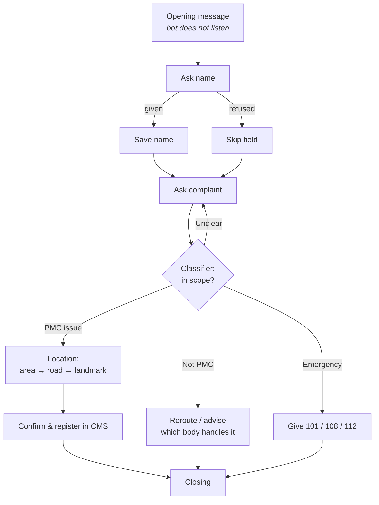

759061357315-mkqm36fcfmtvniesm9dpet4spcpkvmed.apps.googleusercontent.com

**Subject:** Proposal: faster, cheaper, reusable voice pipeline for the PMC calling bot (and future lines)

Hi [Name],

This mail summarises where the PMC calling bot stands on latency and cost, and proposes the next version of the pipeline. The new version follows a clearer call flow and is built so that the same engine can run other helplines with only a config file.

## 1. Where we are today

| Area | Current state (measured, 15 Oct) |
|---|---|
| Cost per call (~3¼ min) | **₹6.3–6.8 ex-GST** (₹7.5–8.0 with GST), down from ₹10–12 after moving to Murf TTS + Gemini |
| Response delay (caller stops → bot speaks) | **~5.3 s** on the current Murf + Gemini stack, against 1.8–2.5 s on the earlier Sarvam stack |
| Prompt size | One ~11k-token instruction set re-sent on every turn (~15 times per call) |
| Noise | Background voices get transcribed as the caller. Noise suppression (RNNoise) was tested and made things worse, so it is off |
| Classification | PMC's 78-category model runs only *after* filing (2.5–22 s), so it can't steer the call |

In short, the switch to cheaper vendors cut cost, but callers now wait noticeably longer, and the single large prompt is hard to adapt to any other use case.

## 2. Proposed call flow

Text version: Opening (no listening) → Name (skip if refused) → Complaint → Classifier → [PMC: Location → Register] / [Not PMC: Reroute/advise] / [Emergency: 101/108/112] → Close

Each step has its own short instructions instead of one 11k-token prompt. That makes each reply faster and cheaper, and lets us tune each step separately. For example, the bot waits less after a yes/no answer and longer while the caller is saying an address.

3. Built once, reusable for other scenarios

The flow above becomes one scenario file (YAML) on top of a general engine we build ourselves. A new use case needs a new config file, not new code:

- Other city complaint lines (e.g. PCMC): same flow, different place list, categories and reroute numbers
- Outbound feedback calls: the bot calls the citizen after resolution: "Is it fixed? Rate 1–5"
- Other helplines: water tanker booking, property tax queries, hospital appointments
- Non-government clients: support tickets, lead capture
- Flows without location: the location step is simply left out

Pluggable components. Each can be chosen per scenario, on-prem or via an online API:

┌─────────────────────────────────┬─────────────────────────────────────────────────────────────────────────────────────────┐
│            Component            │                                         Options                                         │
├─────────────────────────────────┼─────────────────────────────────────────────────────────────────────────────────────────┤
│ Classifier                      │ LLM-based (zero added delay), PMC's own model on their server, or a local on-prem model │
├─────────────────────────────────┼─────────────────────────────────────────────────────────────────────────────────────────┤
│ LLM                             │ Sarvam, Gemini, or any OpenAI-compatible model. Can differ per step                     │
├─────────────────────────────────┼─────────────────────────────────────────────────────────────────────────────────────────┤
│ Speech-to-text / Text-to-speech │ Sarvam, Murf, ElevenLabs, Google, …                                                     │
├─────────────────────────────────┼─────────────────────────────────────────────────────────────────────────────────────────┤
│ Output                          │ PMC CMS, generic webhook, our own database                                              │
└─────────────────────────────────┴─────────────────────────────────────────────────────────────────────────────────────────┘

4. Cost estimates (₹ per call, ex-GST)

┌────────────────────────────────────────┬───────────┬────────────────┬────────────────┬───────────┬──────────┬──────────┐
│                Scenario                │ Telephony │ Speech-to-text │ Text-to-speech │    LLM    │  Total   │ With GST │
├────────────────────────────────────────┼───────────┼────────────────┼────────────────┼───────────┼──────────┼──────────┤
│ Today (~3¼ min)                        │ 2.60      │ 1.63           │ 1.21           │ 0.78–1.28 │ 6.3–6.8  │ 7.5–8.0  │
├────────────────────────────────────────┼───────────┼────────────────┼────────────────┼───────────┼──────────┼──────────┤
│ New PMC flow (~3¼ min)                 │ 2.60      │ 1.63           │ ~1.10          │ 0.45–1.05 │ 5.8–6.4  │ 6.8–7.6  │
├────────────────────────────────────────┼───────────┼────────────────┼────────────────┼───────────┼──────────┼──────────┤
│ Out-of-scope call, rerouted (~70 s)    │ 1.30      │ 0.58           │ 0.30           │ ~0.10     │ ≈2.3     │ ≈2.7     │
├────────────────────────────────────────┼───────────┼────────────────┼────────────────┼───────────┼──────────┼──────────┤
│ Outbound feedback call (~75 s)         │ 1.30*     │ 0.63           │ 0.35           │ 0.05–0.15 │ ≈2.3–2.5 │ ≈2.8     │
├────────────────────────────────────────┼───────────┼────────────────┼────────────────┼───────────┼──────────┼──────────┤
│ Generic helpline, no location (~2 min) │ 1.30      │ 1.00           │ 0.75           │ 0.20–0.50 │ ≈3.3–3.6 │ 3.9–4.2  │
└────────────────────────────────────────┴───────────┴────────────────┴────────────────┴───────────┴──────────┴──────────┘

Monthly at 100 complaints/day: ~₹20–22k ex-GST (≈₹24–26k with GST), including ₹2,600 fixed (number rental + server).

Notes:
- Telephony and speech-to-text are ~65% of every call and don't change with this work. The gains are mainly in speed, early exit for out-of-scope calls, and reuse, not a large cost cut.
- Murf's TTS rate ($0.01 per 1,000 characters) is from Murf's product page and third-party listings, not yet confirmed on our invoice. *Vobiz's outbound rate is not yet confirmed; the inbound rate is used above.
- USD prices are converted at ₹88/$.

5. Plan and timeline

┌───────────────────────┬─────────────────────────────────────────────────────────────────────────────────────────────┬─────────┐
│         Phase         │                                            What                                             │ Effort  │
├───────────────────────┼─────────────────────────────────────────────────────────────────────────────────────────────┼─────────┤
│ A. Quick wins         │ Cache the greeting audio, mute the caller during the opening, LLM connection warm-up,       │ 1–2     │
│ (current bot)         │ 10-call A/B of Sarvam vs Gemini for speed                                                   │ days    │
├───────────────────────┼─────────────────────────────────────────────────────────────────────────────────────────────┼─────────┤
│ B. Engine foundation  │ Config format, stage handling, provider plug-ins; current bot runs unchanged on it first    │ ~1 week │
│                       │ (parity)                                                                                    │         │
├───────────────────────┼─────────────────────────────────────────────────────────────────────────────────────────────┼─────────┤
│ C. New PMC flow       │ Name-first order, classifier gate, reroute/advise, split location step                      │ ~3 days │
├───────────────────────┼─────────────────────────────────────────────────────────────────────────────────────────────┼─────────┤
│ D. Outbound + other   │ Feedback-call scenario, webhook output                                                      │ 2–3     │
│ outputs               │                                                                                             │ days    │
├───────────────────────┼─────────────────────────────────────────────────────────────────────────────────────────────┼─────────┤
│ E. Latency & noise    │ Per-step listening times, filtering of noise-like answers, optional paid noise-removal      │ 2 days  │
│ tuning                │ trial                                                                                       │         │
├───────────────────────┼─────────────────────────────────────────────────────────────────────────────────────────────┼─────────┤
│ F. Reuse proof        │ Second scenario (e.g. water tanker, no location)                                            │ 1–2     │
│                       │                                                                                             │ days    │
└───────────────────────┴─────────────────────────────────────────────────────────────────────────────────────────────┴─────────┘

Total ≈ 3 weeks after the quick wins. Phase A alone should bring the response delay from ~5.3 s back to roughly 2–2.5 s (target; to be confirmed with test calls).

6. Decisions needed

7. Reroute numbers: today the bot is not allowed to give any other department's number. Can PMC approve a fixed list (e.g. MSEDCL, police, PMPML)? Until then the bot will name the right body but give no number.
8. Order of steps: location is asked before registering, because the CMS needs the address to file. Please confirm.
9. Go-ahead for Phase A, which is independent of the larger build.

The detailed technical plan is in the repo at docs/scenario-engine-plan.md.

Regards,
[Your name]